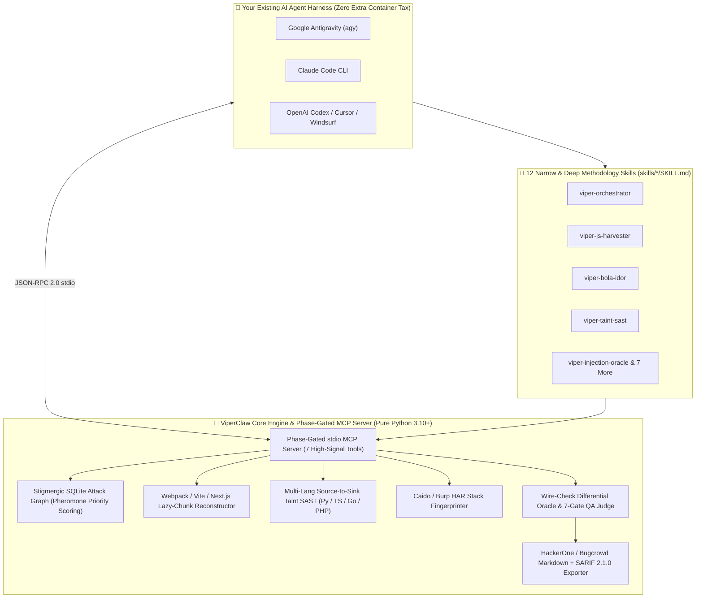

<div align="center">


<br />

# 🐍 ViperClaw

### **The Universal AI Offensive Security Harness, Stigmergic Swarm Graph & Proof Oracle**

*Stop wrapping LLMs around 150 noisy CLI scanners. Give your coding agent a senior bug hunter's methodology, a stigmergic attack graph, deep JS/taint analyzers, and a deterministic wire-check proof oracle.*

<p align="center">
  <a href="https://github.com/zahidoverflow/viperclaw/actions"></a>
  <a href="https://github.com/zahidoverflow/viperclaw/blob/main/LICENSE"></a>
  <a href="https://www.python.org/"></a>
  <a href="#-phase-gated-mcp-server-viperclaw-mcp"></a>
  <a href="#-the-12-methodology-driven-skills"></a>
  <a href="https://github.com/zahidoverflow"></a>
</p>

<p align="center">
  <a href="#-why-most-ai-pentesting-agents-fail-in-practice">Why Agents Fail</a> •
  <a href="#-how-viperclaw-fixes-it-architecture">Architecture</a> •
  <a href="#-2026-ai-pentesting-framework-comparison">2026 Landscape Matrix</a> •
  <a href="#-60-second-quickstart">Quickstart</a> •
  <a href="#-the-12-methodology-driven-skills">12 Skills</a> •
  <a href="#-phase-gated-mcp-server-viperclaw-mcp">MCP Server</a>
</p>

</div>

---

## 💥 Why Most "AI Pentesting Agents" Fail in Practice

Across the 2025–2026 offensive AI ecosystem, two flawed patterns dominate:

1. **The "Wrap 150 Scanners" Trap (*Broad, Noisy & Shallow*):**
   Frameworks that expose 150–200 Kali CLI tools (`nmap`, `nuclei`, `ffuf`, `sqlmap`) directly to an LLM suffer from **context-window rot** and **tool-selection paralysis**. The model runs default scanner flags, triggers Cloudflare/Akamai WAF blocks within 10 seconds, misses multi-step business logic, and hallucinates critical findings out of `"200 OK"` soft-block challenge pages.
2. **The Heavy Container Tax (*Expensive & Rigid*):**
   Monolithic autonomous stacks force you to spin up 4–6 Docker containers, external graph databases, and separate API keys that burn **$50–$150+ per run**—even when you *already* have an elite agent harness running on your machine (**Google Antigravity**, **Claude Code**, **OpenAI Codex**, or **Cursor**).

### ⚡ The ViperClaw Paradigm Shift

> *"A handful of sharp, deeply researched, methodology-driven skills paired with a deterministic verification oracle will outperform a giant 200-tool wrapper almost every time."*

**ViperClaw** is a **zero-dependency Python engine + Phase-Gated MCP Server + 12 Cross-Harness Skill Suite** that upgrades the AI agent you already use into a disciplined offensive security operator:

* 🕸️ **Stigmergic Attack Surface Knowledge Graph (`viperclaw.core.graph`):** Zero-setup SQLite graph with **pheromone priority scoring**. Parallel subagents share state, boost high-signal anomalies, evaporate dead ends, and export live **Mermaid** topologies.
* 🧩 **Deep JS & Lazy-Chunk Reconstructor (`viperclaw.analyzers.js_harvester`):** Reconstructs hidden **Webpack, Vite, and Next.js lazy-loaded chunk URLs** (`<id>.<hash>.chunk.js`) that never load until an admin route fires—extracting API routes, GraphQL operations, DOM sinks, and leaked secrets.
* 🔬 **Multi-Language Source-to-Sink Taint SAST (`viperclaw.analyzers.taint`):** Traces remote user input sources (`request.args`, `req.body`, `r.URL.Query()`, `$_POST`) to dangerous sinks (RCE, SQLi, SSRF, LFI, Deserialization, SSTI) across **Python, TypeScript/JS, Go, and PHP** with zero legacy `jedi` / Python 3.10 lock-in.
* 🕵️ **Proxy & HAR Stack Fingerprinter (`viperclaw.analyzers.proxy_fingerprint`):** Infers backend frameworks (FastAPI, NestJS, Spring Boot, Laravel, Rails, GraphQL) from error envelopes, cookie signatures, and HAR captures from **Caido** or **Burp Suite**.
* 🛡️ **Wire-Check Proof Oracle & 7-Gate QA Judge (`viperclaw.core.oracle`):** Enforces **"No Receipt, No Report."** Automatically filters Cloudflare/Akamai/CloudFront `"200 OK"` soft-blocks, computes structural JSON diffs for BOLA/IDOR, calculates exact **CVSS v3.1** vectors, and exports **HackerOne/Bugcrowd Markdown + SARIF 2.1.0**.

---

## 🏗️ How ViperClaw Fixes It (Architecture)



---

## 📊 2026 AI Pentesting Framework Comparison

How **ViperClaw** compares against the leading open-source AI pentesting frameworks across the 4 architectural families:

| Capability / Architecture | **🐍 ViperClaw** | **Strix** (`usestrix`) | **Shannon** (`KeygraphHQ`) | **PentAGI** (`vxcontrol`) | **RedAmon** (`samugit83`) | **Raptor** (`gadievron`) | **HexStrike AI** (`0x4m4`) | **Vulnhuntr** (`protectai`) |
| :--- | :---: | :---: | :---: | :---: | :---: | :---: | :---: | :---: |
| **Primary Family** | **Unified Harness + MCP + Skills** | Autonomous Docker Agent | Source-Aware Web Exploiter | Autonomous Multi-Agent | Graph + Kali Agent | Code + Binary Research | 150-Tool MCP Wrapper | Python AST Taint SAST |
| **Works Natively Inside Antigravity / Claude Code / Codex** | ✅ **Native (Skills + MCP)** | ⚠️ Via CLI wrapper | ⚠️ Via CLI wrapper | ❌ Standalone Stack | ✅ MCP Support | ✅ Claude Code | ✅ MCP Only | ❌ Standalone CLI |
| **Context-Window Efficiency** | ✅ **7 Phase-Gated Tools** | ✅ Scoped | ✅ Scoped | ✅ Role-Split | ✅ Graph-Scoped | ✅ Modular | ❌ **150+ Tools Dumped** | ✅ Call-Slice Only |
| **Zero-Setup Attack Surface Graph** | ✅ **Built-in SQLite + Mermaid** | ❌ | ❌ | ⚠️ Needs Neo4j / PG | ⚠️ Needs Neo4j | ❌ | ❌ | ❌ |
| **SPA Lazy-Chunk Reconstruction (Webpack/Vite/Next.js)** | ✅ **Built-in** | ⚠️ Partial | ⚠️ Partial | ❌ | ❌ | ❌ | ❌ | ❌ |
| **Multi-Language White-Box Taint SAST** | ✅ **Py / TS / JS / Go / PHP** | ✅ Dynamic + Code | ✅ White-Box | ❌ Black-Box | ❌ Black-Box | ✅ Semgrep / CodeQL | ❌ | ⚠️ **Python 3.10 Only** |
| **Deterministic WAF Soft-Block & BOLA Diff Oracle** | ✅ **Built-in (`ProofOracle`)** | ✅ PoC Validation | ✅ PoC Validation | ⚠️ LLM-Judged | ✅ Verified | ✅ Exploit Proof | ❌ Raw Stdout | ❌ Static Only |
| **7-Gate Bounty Triage + CVSS 3.1 + SARIF 2.1.0** | ✅ **Built-in** | ✅ SARIF | ✅ SARIF | ⚠️ Basic Report | ✅ Full Report | ⚠️ Research Notes | ❌ | ❌ |
| **Runtime Dependencies** | ✅ **0 (Pure Python Stdlib)** | Docker + LiteLLM | Node.js + Docker | Docker + Postgres + Go | Docker + Neo4j + Kali | CodeQL + AFL++ | Python + 150 CLI Tools | Python 3.10 + `jedi` |

---

## 🚀 60-Second Quickstart

### 1. Clone & Install ViperClaw (Zero External Dependencies)

```bash
git clone https://github.com/zahidoverflow/viperclaw.git
cd viperclaw
pip install -e .
```

*(Because ViperClaw's core uses 100% pure Python 3.10+ standard library modules, installation finishes in under 2 seconds on Linux, macOS, Windows, WSL, Docker, or Android Termux.)*

### 2. Install the 12 Methodology Skills into Your AI Agent Harness

Install all 12 skills into **Google Antigravity (`~/.agents/skills`)**, **Claude Code (`~/.claude/skills`)**, **OpenAI Codex (`~/.codex/skills`)**, **Cursor (`~/.cursor/skills`)**, or **all at once**:

```bash
# Install for Google Antigravity
viperclaw skills install --target antigravity

# Install for Claude Code
viperclaw skills install --target claude

# Install for OpenAI Codex / Cursor / All Harnesses
viperclaw skills install --target all
```

**Using Claude Code Plugin Marketplace?** You can also install directly inside Claude Code:
```text
/plugin marketplace add zahidoverflow/viperclaw
/plugin install viperclaw@viperclaw
```

### 3. Connect the Phase-Gated MCP Server (`viperclaw mcp`)

Add ViperClaw to your agent's `mcp_config.json` / `.mcp.json` (Antigravity, Claude Code, Cursor, Windsurf):

```json
{
  "mcpServers": {
    "viperclaw": {
      "command": "viperclaw",
      "args": ["mcp"]
    }
  }
}
```

Or via the Claude Code CLI:
```bash
claude mcp add viperclaw -- viperclaw mcp
```

---

## 🛠️ Standalone CLI Showcase

You can also run every ViperClaw analyzer directly from your terminal or CI/CD pipeline:

### 1. Reconstruct Hidden Lazy Chunks & Extract API/IDOR Leads from JS Bundles
```bash
viperclaw harvest-js ./downloaded_bundles \
  --base-url https://app.target.tld/ \
  --graph-db .viperclaw/graph.db
```

### 2. Run Multi-Language Source-to-Sink Taint SAST (Python, TS/JS, Go, PHP)
```bash
viperclaw taint ./target-repo --graph-db .viperclaw/graph.db
```

### 3. Fingerprint Backend Frameworks & Sibling API Hosts from Caido / Burp HAR Captures
```bash
viperclaw fingerprint ./caido_export.har --domain target.tld
```

### 4. View Pheromone-Ranked Attack Leads & Export Mermaid Attack Graph
```bash
viperclaw graph --db .viperclaw/graph.db
viperclaw graph --db .viperclaw/graph.db --mermaid
```

### 5. Validate a Candidate Finding Through the 7-Question Gate & Export SARIF 2.1.0 + Bounty Report
```bash
viperclaw verify \
  --title "Cross-Tenant BOLA on /api/v2/invoices/{id} Exposes Customer Billing PII" \
  --vuln-class "Broken Object Level Authorization (CWE-639)" \
  --asset "https://api.example.com/api/v2/invoices/1042" \
  --request $'GET /api/v2/invoices/1042 HTTP/1.1\nHost: api.example.com\nAuthorization: Bearer <TENANT_B_JWT>' \
  --response $'HTTP/1.1 200 OK\nContent-Type: application/json\n\n{"invoice_id":1042,"tenant_id":"tenant_a","total":"$14,200.00"}' \
  --sarif-out findings.sarif
```

---

## 🎯 The 12 Methodology-Driven Skills

Each skill in [`skills/`](skills/) encodes a senior security researcher's decision tree, coverage matrix, bypass ladder, and stopping conditions:

| # | Skill Name | Focus Area & Methodology |
| :--- | :--- | :--- |
| **01** | [`viper-orchestrator`](skills/viper-orchestrator/SKILL.md) | **Master 5-Phase Non-Linear Orchestrator:** Stigmergic Attack Graph prioritization, hypothesis decomposition, parallel subagent routing, and 7-Gate QA enforcement. |
| **02** | [`viper-js-harvester`](skills/viper-js-harvester/SKILL.md) | **Deep JS & Lazy-Chunk Harvester:** Reconstructs unloaded Webpack/Vite/Next.js chunk manifests, extracts hidden admin routes, GraphQL ops, DOM sinks, and secrets. |
| **03** | [`viper-proxy-fingerprint`](skills/viper-proxy-fingerprint/SKILL.md) | **HTTP & Proxy Traffic Fingerprinter:** Maps sibling API hosts, framework error shapes (FastAPI, NestJS, Spring, Laravel), auth schemes, and Soft-200 WAF traps. |
| **04** | [`viper-bola-idor`](skills/viper-bola-idor/SKILL.md) | **Cross-Tenant BOLA / IDOR / BFLA Hunter:** Multi-role authorization matrix (Tenant A vs Tenant B vs Unauth), ID mutation, parameter pollution, and JSON key diff verification. |
| **05** | [`viper-injection-oracle`](skills/viper-injection-oracle/SKILL.md) | **Precision Injection Oracle (SQLi / NoSQLi / SSTI / RCE):** Zero-noise true/false differential pairs, manual DBMS/template fingerprinting, and timing/OOB proof. |
| **06** | [`viper-ssrf-cloud`](skills/viper-ssrf-cloud/SKILL.md) | **SSRF & Cloud Metadata Hunter:** URL parser differentials, redirect chains, IMDSv1/v2, GCP/K8s service discovery, and OOB confirmation. |
| **07** | [`viper-auth-oauth-jwt`](skills/viper-auth-oauth-jwt/SKILL.md) | **Auth, OAuth 2.0 / OIDC & JWT Playbook:** `redirect_uri` parser bypasses, pre-account takeover email collisions, JWT key confusion (`RS256`→`HS256`), and `kid` traversal. |
| **08** | [`viper-graphql-ws`](skills/viper-graphql-ws/SKILL.md) | **GraphQL & WebSocket Auditor:** Introspection bypass, field suggestion clairvoyance, nested edge BOLA, alias batching, CSWSH, and WS subscription IDOR. |
| **09** | [`viper-race-logic`](skills/viper-race-logic/SKILL.md) | **Race Condition & Business Logic Hunter:** Single-packet HTTP/2 bursts, TOCTOU quota/coupon overruns, idempotency flaws, and state-machine skipping. |
| **10** | [`viper-taint-sast`](skills/viper-taint-sast/SKILL.md) | **White-Box Source-to-Sink Taint SAST:** Traces remote user inputs to dangerous sinks across Python, TypeScript/JS, Go, and PHP and synthesizes dynamic PoCs. |
| **11** | [`viper-ai-llm-redteam`](skills/viper-ai-llm-redteam/SKILL.md) | **Agentic AI, LLM & MCP Red-Team Playbook:** Indirect prompt injection, MCP tool-call argument hijacking, cross-tenant RAG vector bleed, and markdown exfiltration. |
| **12** | [`viper-proof-judge`](skills/viper-proof-judge/SKILL.md) | **Zero-Context Adversarial Proof Judge:** Enforces *"No Receipt, No Report"*, runs the 7-Question Pre-Submission Gate, scores CVSS 3.1, and writes H1/Bugcrowd reports. |

---

## 🔌 Phase-Gated MCP Server (`viperclaw mcp`)

Instead of polluting your LLM's context window with 150 raw CLI tool wrappers, `viperclaw mcp` exposes **7 high-signal, deterministic tools**:

| MCP Tool Name | Purpose |
| :--- | :--- |
| `viper_graph_upsert` | Upsert hosts, endpoints, lazy chunks, taint sinks, or findings into the Stigmergic SQLite Attack Graph with pheromone boosts. |
| `viper_graph_leads` | Query top pheromone-ranked attack leads and export a live Mermaid topology diagram. |
| `viper_harvest_js` | Reconstruct Webpack/Vite/Next.js lazy chunks and harvest endpoints, IDOR/SSRF candidates, GraphQL ops, and secrets. |
| `viper_taint_scan` | Execute multi-language white-box source-to-sink taint analysis across Python, TS/JS, Go, and PHP. |
| `viper_fingerprint_traffic` | Fingerprint backend frameworks, WAFs, sibling API hosts, and error envelopes from HAR captures or HTTP headers/body. |
| `viper_diff_oracle` | Compare baseline vs. mutated/cross-tenant HTTP responses to confirm BOLA/IDOR and filter Cloudflare/Akamai Soft-200 blocks. |
| `viper_verify_and_report` | Run the 7-Question Triage Gate, calculate exact CVSS v3.1 scores, and generate a submission-ready Markdown report. |

---

## 🧪 Running the Test Suite

```bash
pytest -v
```

---

## ⚠️ Legal & Responsible Use Disclaimer

**ViperClaw** is developed strictly for **authorized security assessments, bug bounty programs with explicit scope permission, educational labs (HackTheBox / TryHackMe / CTFs), and defensive code auditing**. Never test targets without prior written authorization.

---

## 📜 License & Author

* **License:** [MIT License](LICENSE) — 100% clean-room open-source implementation.
* **Created by:** **Zahidul Islam ([@zahidoverflow](https://github.com/zahidoverflow))**
* ⭐ **If ViperClaw sharpens your offensive workflows, star the repository and share it with the community!**
