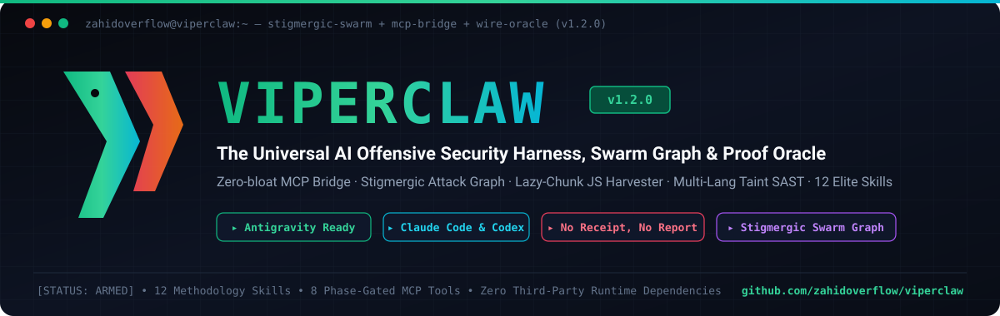
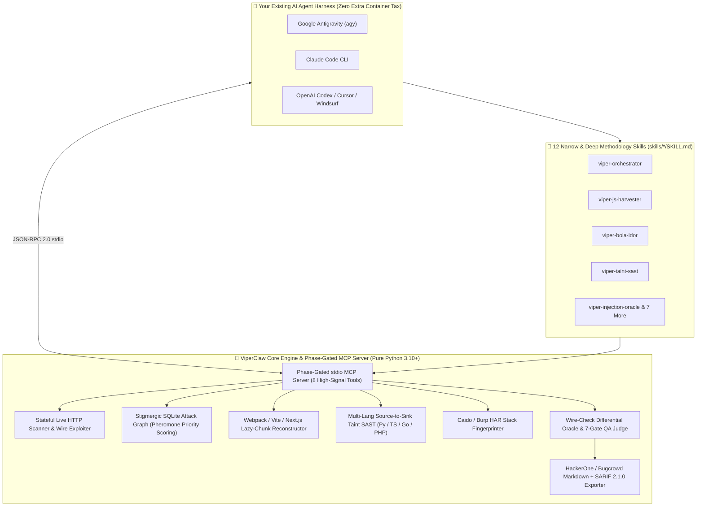

<div align="center">



<br />

# 🐍 ViperClaw: AI Pentesting Framework, Bug Bounty MCP Server & Offensive Security Skills

### **The Universal AI Offensive Security Harness, Stigmergic Swarm Graph, SAST/DAST Taint Engine & Wire-Check Proof Oracle**

*Stop wrapping LLMs around 150 noisy CLI scanners. Upgrade **Google Antigravity**, **Claude Code**, **OpenAI Codex**, and **Cursor** with a senior bug hunter's methodology, a stigmergic attack graph, deep JS/taint analyzers, and a deterministic wire-check proof oracle.*

<p align="center">
  <a href="https://github.com/zahidoverflow/viperclaw/releases"></a>
  <a href="https://github.com/zahidoverflow/viperclaw/actions"></a>
  <a href="https://github.com/zahidoverflow/viperclaw/blob/main/LICENSE"></a>
  <a href="https://www.python.org/"></a>
  <a href="#-phase-gated-mcp-server-viperclaw-mcp"></a>
  <a href="#-the-12-methodology-driven-skills"></a>
  <a href="https://github.com/zahidoverflow/viperclaw/stargazers"></a>
</p>

<p align="center">
  <a href="#-why-most-ai-pentesting-agents-fail-in-practice">Why Agents Fail</a> •
  <a href="#-how-viperclaw-fixes-it-architecture">Architecture</a> •
  <a href="#-2026-ai-pentesting-framework-comparison">2026 Comparison Matrix</a> •
  <a href="#-60-second-quickstart">60s Quickstart</a> •
  <a href="#-the-12-methodology-driven-skills">12 Skills</a> •
  <a href="#-phase-gated-mcp-server-viperclaw-mcp">MCP Server</a> •
  <a href="#-validated-dvwa-benchmark-scorecard-white-box--black-box">DVWA Benchmark</a> •
  <a href="#-frequently-asked-questions-faq">FAQ</a>
</p>

</div>

---

## 💥 Why Most "AI Pentesting Agents" Fail in Practice

Across the 2025–2026 **AI penetration testing** and **automated bug bounty** ecosystem, two flawed architectural patterns dominate:

1. **The "Wrap 150 Scanners" Trap (*Broad, Noisy & Shallow*):**
   Frameworks that expose 150–200 Kali Linux CLI tools (`nmap`, `nuclei`, `ffuf`, `sqlmap`) directly to an LLM suffer from **context-window rot** and **tool-selection paralysis**. The model runs default scanner flags, triggers Cloudflare/Akamai/Imperva WAF blocks within 10 seconds, misses multi-step business logic, and hallucinates critical findings out of `"200 OK"` soft-block challenge pages.
2. **The Heavy Container Tax (*Expensive & Rigid*):**
   Monolithic autonomous pentesting stacks force you to spin up 4–6 Docker containers, external Neo4j/Postgres databases, and separate API keys that burn **$50–$150+ per run**—even when you *already* have a frontier AI coding agent running on your machine (**Google Antigravity**, **Claude Code**, **OpenAI Codex**, **Cursor**, or **Windsurf**).

### ⚡ The ViperClaw Paradigm Shift

> *"A handful of sharp, deeply researched, methodology-driven skills paired with a deterministic verification oracle will outperform a giant 200-tool wrapper almost every time."*

**ViperClaw** (`viperclaw` / `vclaw`) is a **zero-dependency Python offensive security engine + Phase-Gated MCP Server + 12 Cross-Harness Skill Suite** that upgrades the AI coding agent you already use into a disciplined penetration tester and bug bounty hunter:

* 🕸️ **Stigmergic Attack Surface Knowledge Graph (`viperclaw.core.graph`):** Zero-setup SQLite graph with **pheromone priority scoring**. Parallel subagents share state, boost high-signal anomalies, evaporate dead ends, and export live **Mermaid** attack-path topologies.
* 🧩 **Deep JS & Lazy-Chunk Reconstructor (`viperclaw.analyzers.js_harvester`):** Reconstructs hidden **Webpack, Vite, and Next.js lazy-loaded chunk URLs** (`<id>.<hash>.chunk.js`, `/_next/static/chunks/...`) that never load until an admin route fires—extracting hidden REST API routes, IDOR/SSRF parameters, GraphQL operations, DOM XSS sinks, and leaked cloud/API secrets.
* 🔬 **Multi-Language Source-to-Sink Taint SAST (`viperclaw.analyzers.taint`):** Traces remote user inputs (`request.args`, `request.GET`, `req.body`, `r.URL.Query()`, `$_GET`/`$_POST`) across forward transitive variable hops to dangerous sinks (**RCE, SQLi, SSRF, LFI/Path Traversal, Insecure Deserialization, XSS, SSTI**) across **Python, TypeScript/JavaScript, Go, and PHP** with context-aware sanitizer de-tainting (`int()`, `intval()`, `PDO::prepare`, `htmlspecialchars`) and zero legacy `jedi` / Python 3.10 lock-in.
* 🌐 **Stateful Live HTTP Scanner & Wire-Check Exploiter (`viperclaw.analyzers.live_scanner`):** Manages authenticated session cookies, extracts anti-CSRF tokens, crawls routes, executes low-noise differential probes (Command Injection, UNION/Blind SQLi, Auth Bypass, LFI, Unrestricted Upload RCE, XSS, Session Predictability, CSRF), and captures raw HTTP proof receipts.
* 🕵️ **Proxy & HAR Stack Fingerprinter (`viperclaw.analyzers.proxy_fingerprint`):** Infers backend frameworks (**FastAPI, NestJS, Spring Boot, Laravel, Ruby on Rails, Express, GraphQL**) and discovers sibling API subdomains from error envelopes, cookie signatures, and `.har` captures from **Caido** or **Burp Suite**.
* 🛡️ **Wire-Check Proof Oracle & 7-Gate QA Judge (`viperclaw.core.oracle`):** Enforces **"No Receipt, No Report."** Automatically filters Cloudflare, Akamai, Imperva, CloudFront, PerimeterX, and DataDome `"200 OK"` soft-blocks, computes structural JSON diffs for **BOLA / IDOR**, calculates exact **CVSS v3.1** base scores/vectors, and exports **HackerOne / Bugcrowd / Intigriti Markdown + SARIF 2.1.0**.

---

## 🏗️ How ViperClaw Fixes It (Architecture)



---

## 📊 2026 AI Pentesting Framework Comparison

How **ViperClaw** compares against leading open-source AI pentesting and bug bounty frameworks (**Strix, Shannon, PentAGI, RedAmon, Raptor, HexStrike AI, Vulnhuntr, CAI, PentestGPT, and Sapper**):

| Capability / Architecture | **🐍 ViperClaw** | **Strix** (`usestrix`) | **Shannon** (`KeygraphHQ`) | **PentAGI** (`vxcontrol`) | **RedAmon** (`samugit83`) | **Raptor** (`gadievron`) | **HexStrike AI** (`0x4m4`) | **Vulnhuntr** (`protectai`) |
| :--- | :---: | :---: | :---: | :---: | :---: | :---: | :---: | :---: |
| **Primary Family** | **Unified Harness + MCP + Skills** | Autonomous Docker Agent | Source-Aware Web Exploiter | Autonomous Multi-Agent | Graph + Kali Agent | Code + Binary Research | 150-Tool MCP Wrapper | Python AST Taint SAST |
| **Works Natively Inside Antigravity / Claude Code / Codex / Cursor** | ✅ **Native (Skills + MCP)** | ⚠️ Via CLI wrapper | ⚠️ Via CLI wrapper | ❌ Standalone Stack | ✅ MCP Support | ✅ Claude Code | ✅ MCP Only | ❌ Standalone CLI |
| **Context-Window Efficiency** | ✅ **8 Phase-Gated Tools** | ✅ Scoped | ✅ Scoped | ✅ Role-Split | ✅ Graph-Scoped | ✅ Modular | ❌ **150+ Tools Dumped** | ✅ Call-Slice Only |
| **Zero-Setup Attack Surface Graph** | ✅ **Built-in SQLite + Mermaid** | ❌ | ❌ | ⚠️ Needs Neo4j / PG | ⚠️ Needs Neo4j | ❌ | ❌ | ❌ |
| **SPA Lazy-Chunk Reconstruction (Webpack/Vite/Next.js)** | ✅ **Built-in** | ⚠️ Partial | ⚠️ Partial | ❌ | ❌ | ❌ | ❌ | ❌ |
| **Multi-Language White-Box Taint SAST** | ✅ **Py / TS / JS / Go / PHP** | ✅ Dynamic + Code | ✅ White-Box | ❌ Black-Box | ❌ Black-Box | ✅ Semgrep / CodeQL | ❌ | ⚠️ **Python 3.10 Only** |
| **Deterministic WAF Soft-Block & BOLA Diff Oracle** | ✅ **Built-in (`ProofOracle`)** | ✅ PoC Validation | ✅ PoC Validation | ⚠️ LLM-Judged | ✅ Verified | ✅ Exploit Proof | ❌ Raw Stdout | ❌ Static Only |
| **7-Gate Bounty Triage + CVSS 3.1 + SARIF 2.1.0** | ✅ **Built-in** | ✅ SARIF | ✅ SARIF | ⚠️ Basic Report | ✅ Full Report | ⚠️ Research Notes | ❌ | ❌ |
| **Runtime Dependencies** | ✅ **0 (Pure Python Stdlib)** | Docker + LiteLLM | Node.js + Docker | Docker + Postgres + Go | Docker + Neo4j + Kali | CodeQL + AFL++ | Python + 150 CLI Tools | Python 3.10 + `jedi` |

---

## 🚀 60-Second Quickstart

### 1. Clone & Install ViperClaw (Zero External Dependencies)

```bash
git clone https://github.com/zahidoverflow/viperclaw.git
cd viperclaw
pip install -e .
```

*(Because ViperClaw's core uses 100% pure Python 3.10+ standard library modules, installation finishes in under 2 seconds on Linux, macOS, Windows, WSL2, Docker, Kali Linux, or Android Termux—providing both `viperclaw` and shorthand `vclaw` CLI commands.)*

### 2. Install the 12 Methodology Skills into Your AI Agent Harness

Install all 12 skills into **Google Antigravity (`~/.agents/skills`)**, **Claude Code (`~/.claude/skills`)**, **OpenAI Codex (`~/.codex/skills`)**, **Cursor (`~/.cursor/skills`)**, or **all at once**:

```bash
# Install for Google Antigravity
viperclaw skills install --target antigravity

# Install for Claude Code
viperclaw skills install --target claude

# Install for OpenAI Codex / Cursor / All Harnesses
viperclaw skills install --target all
```

**Using Claude Code Plugin Marketplace?** You can also install directly inside Claude Code:
```text
/plugin marketplace add zahidoverflow/viperclaw
/plugin install viperclaw@viperclaw
```

### 3. Connect the Phase-Gated MCP Server (`viperclaw mcp`)

Add ViperClaw to your agent's `mcp_config.json` / `.mcp.json` (Antigravity, Claude Code, Cursor, Windsurf, Cline):

```json
{
  "mcpServers": {
    "viperclaw": {
      "command": "viperclaw",
      "args": ["mcp"]
    }
  }
}
```

Or via the Claude Code CLI:
```bash
claude mcp add viperclaw -- viperclaw mcp
```

---

## 🛠️ Standalone CLI Showcase (`viperclaw` / `vclaw`)

You can run every ViperClaw offensive analyzer directly from your terminal or CI/CD pipeline:

### 0. Run a Stateful Live Web Scan & Wire-Verified Exploit Suite (`viperclaw scan`)
Automatically manages session cookies, extracts anti-CSRF tokens, crawls routes, executes wire-verified exploit probes, populates the Stigmergic Attack Graph, and emits SARIF 2.1.0 + Markdown bounty reports:
```bash
viperclaw scan http://127.0.0.1:4280 \
  --db .viperclaw/graph.db \
  --report-md bounty_report.md \
  --report-sarif findings.sarif
```

### 1. Reconstruct Hidden Lazy Chunks & Extract API/IDOR Leads from JS Bundles (`viperclaw harvest-js`)
```bash
viperclaw harvest-js ./downloaded_bundles \
  --base-url https://app.target.tld/ \
  --db .viperclaw/graph.db \
  --output js_recon.json
```

### 2. Run Multi-Language Source-to-Sink Taint SAST (`viperclaw taint`)
```bash
viperclaw taint ./target-repo \
  --db .viperclaw/graph.db \
  --output taint_flows.json
```

### 3. Fingerprint Backend Frameworks & Sibling API Hosts from Caido / Burp HAR Captures (`viperclaw fingerprint`)
```bash
viperclaw fingerprint ./caido_export.har \
  --domain target.tld \
  --output tech_stack.json
```

### 4. View Pheromone-Ranked Attack Leads & Export Mermaid Attack Graph (`viperclaw graph`)
```bash
viperclaw graph --db .viperclaw/graph.db --top-leads 10 --decay 0.9
viperclaw graph --db .viperclaw/graph.db --mermaid
```

### 5. Validate a Candidate Finding Through the 7-Question Gate & Export SARIF 2.1.0 + Bounty Report (`viperclaw verify`)
```bash
# Verify from a JSON finding file or inline receipts:
viperclaw verify ./candidate_finding.json \
  --report-md h1_submission.md \
  --report-sarif findings.sarif
```

---

## 🎯 The 12 Methodology-Driven Skills

Each skill in [`skills/`](skills/) encodes a senior security researcher's decision tree, coverage matrix, bypass ladder, and stopping conditions:

| # | Skill Name | Focus Area & Offensive Methodology |
| :--- | :--- | :--- |
| **01** | [`viper-orchestrator`](skills/viper-orchestrator/SKILL.md) | **Master 5-Phase Non-Linear Orchestrator:** Stigmergic Attack Graph prioritization, hypothesis decomposition, parallel subagent routing, and 7-Gate QA enforcement. |
| **02** | [`viper-js-harvester`](skills/viper-js-harvester/SKILL.md) | **Deep JS & Lazy-Chunk Harvester:** Reconstructs unloaded Webpack/Vite/Next.js chunk manifests, extracts hidden admin routes, GraphQL ops, DOM sinks, and secrets. |
| **03** | [`viper-proxy-fingerprint`](skills/viper-proxy-fingerprint/SKILL.md) | **HTTP & Proxy Traffic Fingerprinter:** Maps sibling API hosts, framework error shapes (FastAPI, NestJS, Spring, Laravel), auth schemes, and Soft-200 WAF traps. |
| **04** | [`viper-bola-idor`](skills/viper-bola-idor/SKILL.md) | **Cross-Tenant BOLA / IDOR / BFLA Hunter:** Multi-role authorization matrix (Tenant A vs Tenant B vs Unauth), ID mutation, parameter pollution, and JSON key diff verification. |
| **05** | [`viper-injection-oracle`](skills/viper-injection-oracle/SKILL.md) | **Precision Injection Oracle (SQLi / NoSQLi / SSTI / RCE):** Zero-noise true/false differential pairs, manual DBMS/template fingerprinting, and timing/OOB proof. |
| **06** | [`viper-ssrf-cloud`](skills/viper-ssrf-cloud/SKILL.md) | **SSRF & Cloud Metadata Hunter:** URL parser differentials, redirect chains, AWS/GCP/Azure IMDSv1/v2, Kubernetes service discovery, and OOB confirmation. |
| **07** | [`viper-auth-oauth-jwt`](skills/viper-auth-oauth-jwt/SKILL.md) | **Auth, OAuth 2.0 / OIDC & JWT Playbook:** `redirect_uri` parser bypasses, pre-account takeover email collisions, JWT key confusion (`RS256`→`HS256`), and `kid` traversal. |
| **08** | [`viper-graphql-ws`](skills/viper-graphql-ws/SKILL.md) | **GraphQL & WebSocket Auditor:** Introspection bypass, field suggestion clairvoyance, nested edge BOLA, alias batching, CSWSH, and WS subscription IDOR. |
| **09** | [`viper-race-logic`](skills/viper-race-logic/SKILL.md) | **Race Condition & Business Logic Hunter:** Single-packet HTTP/2 bursts, TOCTOU quota/coupon overruns, idempotency flaws, and state-machine skipping. |
| **10** | [`viper-taint-sast`](skills/viper-taint-sast/SKILL.md) | **White-Box Source-to-Sink Taint SAST:** Traces remote user inputs to dangerous sinks across Python, TypeScript/JS, Go, and PHP and synthesizes dynamic PoCs. |
| **11** | [`viper-ai-llm-redteam`](skills/viper-ai-llm-redteam/SKILL.md) | **Agentic AI, LLM & MCP Red-Team Playbook:** Indirect prompt injection, MCP tool-call argument hijacking, cross-tenant RAG vector bleed, and markdown exfiltration. |
| **12** | [`viper-proof-judge`](skills/viper-proof-judge/SKILL.md) | **Zero-Context Adversarial Proof Judge:** Enforces *"No Receipt, No Report"*, runs the 7-Question Pre-Submission Gate, scores CVSS 3.1, and writes H1/Bugcrowd reports. |

---

## 🔌 Phase-Gated MCP Server (`viperclaw mcp`)

Instead of polluting your LLM's context window with 150 raw CLI tool wrappers, `viperclaw mcp` exposes **8 high-signal, deterministic Model Context Protocol (MCP) tools**:

| MCP Tool Name | Purpose |
| :--- | :--- |
| `viper_live_scan` | Execute a stateful, authenticated HTTP dynamic scan against a live web target/lab, proving exploits over the wire and updating the Attack Graph. |
| `viper_graph_upsert` | Upsert hosts, endpoints, lazy chunks, taint sinks, or findings into the Stigmergic SQLite Attack Graph with pheromone boosts. |
| `viper_graph_leads` | Query top pheromone-ranked attack leads and export a live Mermaid topology diagram. |
| `viper_harvest_js` | Reconstruct Webpack/Vite/Next.js lazy chunks and harvest endpoints, IDOR/SSRF candidates, GraphQL ops, and secrets. |
| `viper_taint_scan` | Execute multi-language white-box source-to-sink taint analysis across Python, TS/JS, Go, and PHP. |
| `viper_fingerprint_traffic` | Fingerprint backend frameworks, WAFs, sibling API hosts, and error envelopes from HAR captures or HTTP headers/body. |
| `viper_diff_oracle` | Compare baseline vs. mutated/cross-tenant HTTP responses to confirm BOLA/IDOR and filter Cloudflare/Akamai Soft-200 blocks. |
| `viper_verify_and_report` | Run the 7-Question Triage Gate, calculate exact CVSS v3.1 scores, and generate a submission-ready Markdown report. |

---

## 🏆 Validated DVWA Benchmark Scorecard (White-Box + Black-Box)

ViperClaw is continuously validated against **Damn Vulnerable Web Application (DVWA)** in both white-box source mode (`viperclaw taint`) and live containerized black-box HTTP mode (`viperclaw scan`):

* **White-Box Taint SAST (`viperclaw taint`):** **19 / 19 (100%)** vulnerability modules detected across `vulnerabilities/*` via forward multi-hop transitive taint tracking, with **0 false positives** on hardened `impossible.php` targets (guarded by `PDO::prepare`, `intval`, `is_numeric`, `in_array` allowlists, and `htmlspecialchars`).
* **Live Black-Box Wire Exploitation (`viperclaw scan`):** **14 / 14 (100%)** of live DVWA vulnerability modules exploited and verified over the wire with raw HTTP request/response receipts (and browser DOM execution verified via BrowserOS):
  1. `VC-LIVE-001` (**HIGH 8.8**): OS Command Injection (`ip=127.0.0.1;id` → `uid=33(www-data)`)
  2. `VC-LIVE-002` (**HIGH 8.1**): UNION-Based SQL Injection (credential hash dump)
  3. `VC-LIVE-003` (**MEDIUM 6.5**): Boolean-Based Blind SQL Injection (True/False differential oracle)
  4. `VC-LIVE-004` (**HIGH 8.1**): SQL Injection Authentication Bypass (`admin' OR '1'='1' LIMIT 1#`)
  5. `VC-LIVE-005` (**HIGH 7.1**): Local File Inclusion (`?page=/etc/passwd` → `root:x:0:0:...`)
  6. `VC-LIVE-006` (**CRITICAL 9.9**): Unrestricted Multipart PHP Upload → Verified Remote Code Execution (`/hackable/uploads/viperclaw_poc.php`)
  7. `VC-LIVE-007` (**MEDIUM 6.1**): Reflected Cross-Site Scripting (unescaped HTML reflection)
  8. `VC-LIVE-008` (**MEDIUM 5.4**): Stored Cross-Site Scripting in Guestbook (`mtxMessage`)
  9. `VC-LIVE-009` (**HIGH 8.2**): Predictable Sequential Session ID (`dvwaSession` $+1$ increment)
  10. `VC-LIVE-010` (**HIGH 8.8**): Cross-Site Request Forgery (CSRF) Unprotected GET Password Reset
  11. `VC-LIVE-011` (**MEDIUM 6.5**): Multi-Step Workflow / CAPTCHA State-Machine Bypass (`step=2` Parameter Manipulation)
  12. `VC-LIVE-012` (**MEDIUM 5.4**): Content Security Policy (CSP) Bypass & Arbitrary External Script Injection (`include` Parameter)
  13. `VC-LIVE-013` (**MEDIUM 6.5**): Client-Side JavaScript Token Algorithm Reversal & Forgery (`md5(rot13("success"))`)
  14. `VC-LIVE-014` (**MEDIUM 6.1**): DOM-Based Cross-Site Scripting (DOM XSS) via Unescaped `document.location.href` into `document.write()`

---

## ❓ Frequently Asked Questions (FAQ)

<details>
<summary><b>What is the best AI pentesting framework in 2026 for Claude Code, Google Antigravity, and Cursor?</b></summary>
<br />
<b>ViperClaw</b> is purpose-built for developers and security researchers who already run frontier coding harnesses (<b>Google Antigravity</b>, <b>Claude Code</b>, <b>OpenAI Codex</b>, or <b>Cursor</b>). Unlike standalone Docker stacks that require 4–6 containers and separate LLM API budgets, ViperClaw installs in 2 seconds with zero third-party dependencies, providing 12 methodology-driven <code>SKILL.md</code> playbooks and an 8-tool Phase-Gated MCP server (<code>viperclaw mcp</code>).
</details>

<details>
<summary><b>How does ViperClaw prevent AI hallucinations and WAF "Soft-200" false positives?</b></summary>
<br />
Generic AI hackbots often mistake a <code>200 OK</code> HTML challenge page from <b>Cloudflare, Akamai, Imperva/Incapsula, AWS CloudFront, PerimeterX, or DataDome</b> for a successful exploit. ViperClaw's deterministic <code>ProofOracle</code> inspects response headers, body signatures, structural JSON key differentials, and Soft-200 error envelopes—enforcing a strict <b>7-Question Pre-Submission Gate</b> (<i>"No Receipt, No Report"</i>) before any finding is marked verified.
</details>

<details>
<summary><b>Can ViperClaw audit both source code (White-Box SAST) and live web applications (Black-Box DAST)?</b></summary>
<br />
Yes. For <b>white-box code auditing</b>, <code>viperclaw taint</code> performs forward multi-hop source-to-sink taint tracking across <b>Python, TypeScript/JavaScript, Go, and PHP</b> while respecting sanitizers (<code>int()</code>, <code>intval()</code>, <code>PDO::prepare</code>, <code>htmlspecialchars</code>). For <b>black-box web & API testing</b>, <code>viperclaw scan</code>, <code>viperclaw harvest-js</code>, and <code>viperclaw fingerprint</code> reconstruct hidden SPA lazy chunks, fingerprint backend stacks from Caido/Burp HAR files, and execute stateful wire-verified probes.
</details>

<details>
<summary><b>How do I cite ViperClaw in security research papers or blog posts?</b></summary>
<br />
This repository includes a standard <a href="CITATION.cff"><code>CITATION.cff</code></a> file. Click the <b>"Cite this repository"</b> button in the GitHub sidebar to copy the BibTeX or APA citation.
</details>

---

## 🧪 Running the Test Suite

```bash
pytest -v
```

---

## ⚠️ Legal & Responsible Use Disclaimer

**ViperClaw** is developed strictly for **authorized security assessments, bug bounty programs with explicit scope permission, educational labs (HackTheBox / TryHackMe / DVWA / CTFs), and defensive code auditing**. Never test targets without prior written authorization.

---

## 📜 License & Author

* **License:** [MIT License](LICENSE) — 100% clean-room open-source implementation.
* **Created by:** **Zahidul Islam ([@zahidoverflow](https://github.com/zahidoverflow))**
* ⭐ **If ViperClaw sharpens your offensive workflows, star the repository and share it with the community!**
