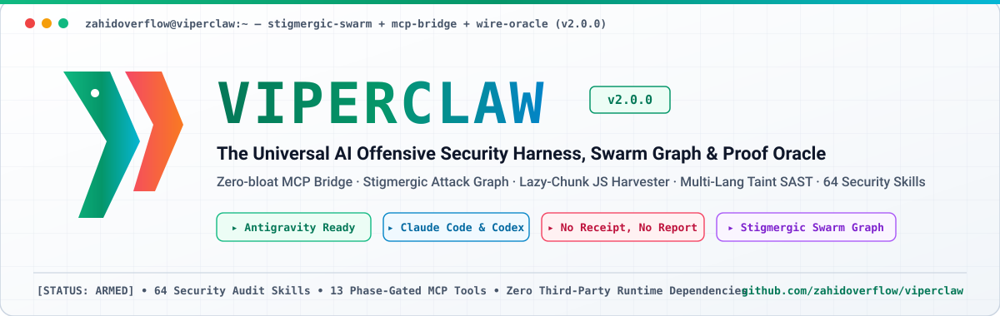

<div align="center">



<p align="center">
  <a href="https://github.com/zahidoverflow/viperclaw/releases"></a>
  <a href="https://github.com/zahidoverflow/viperclaw/actions"></a>
  <a href="https://www.python.org/"></a>
  <a href="#-cli--mcp-reference"></a>
  <a href="#-offensive-skill-playbooks"></a>
  <a href="https://github.com/zahidoverflow/viperclaw/blob/main/LICENSE"></a>
</p>

<p align="center">
  <b>ViperClaw</b> (<code>viperclaw</code> / <code>vclaw</code>) upgrades <b>Google Antigravity</b>, <b>Claude Code</b>, <b>OpenAI Codex</b>, and <b>Cursor</b> into a methodology-driven offensive security &amp; bug bounty platform—combining <b>34 security audit skills</b>, a <b>13-tool Phase-Gated MCP server</b>, a <b>BrowserOS Neo session bridge</b>, a <b>Stigmergic SQLite Attack Graph</b>, <b>Race / JWT / GraphQL / OOB / SAST / DAST engines</b>, and a <b>deterministic Proof Oracle</b> with <b>zero third-party runtime dependencies</b>.
</p>

<p align="center">
  <a href="https://zahidoverflow.github.io/viperclaw/"><b>Website</b></a> •
  <a href="docs/README.md"><b>User Guide</b></a> •
  <a href="#-quickstart"><b>Quickstart</b></a> •
  <a href="#-architecture"><b>Architecture</b></a> •
  <a href="#-cli--mcp-reference"><b>CLI &amp; MCP</b></a> •
  <a href="#-offensive-skill-playbooks"><b>34 Skills</b></a> •
  <a href="#-benchmarks--comparison"><b>Benchmarks</b></a>
</p>

</div>

---

## ⚡ Why ViperClaw?

Most "AI pentesting wrappers" fail in production: dumping **150+ noisy CLI scanners** into an LLM causes context-window rot and instant WAF blocks, while monolithic Docker stacks require **4–6 containers and separate API budgets** when you already run a frontier coding agent locally.

ViperClaw pairs **14 methodology-driven playbooks** with **10 zero-dependency Python 3.10+ offensive engines** and a strict **"No Receipt, No Report" Proof Oracle**:

| Core&nbsp;Subsystem | Capability &amp; Implementation |
| :--- | :--- |
| 🕸️&nbsp;[**Stigmergic&nbsp;Graph**](src/viperclaw/core/graph.py) | Zero-setup SQLite knowledge graph with pheromone priority scoring, decay &amp; Mermaid topology export. |
| 🌐&nbsp;[**BrowserOS&nbsp;&amp;&nbsp;Live&nbsp;DAST**](src/viperclaw/analyzers/browser_bridge.py) | Bridges signed-in **BrowserOS Neo** tabs (`fetch`/`XHR` hooks, JWTs, storage) + **14 wire-verified HTTP exploit probes**. |
| ⚡&nbsp;[**Barrier&nbsp;Race&nbsp;Engine**](src/viperclaw/analyzers/race_engine.py) | Pre-connected socket pool synchronized via `threading.Barrier` to prove TOCTOU double-spend &amp; coupon overruns. |
| 🔑&nbsp;[**JWT&nbsp;&amp;&nbsp;GraphQL&nbsp;Engines**](src/viperclaw/analyzers/jwt_engine.py) | HMAC secret cracker, `alg:none` / `kid` / `RS256`→`HS256` token forger, plus GraphQL Clairvoyance &amp; batching probes. |
| 📡&nbsp;[**OOB&nbsp;&amp;&nbsp;JS&nbsp;Harvester**](src/viperclaw/analyzers/oob_engine.py) | HMAC-tagged blind OOB canary matrix + ephemeral callback listener, plus **Webpack / Vite / Next.js** lazy-chunk reconstruction. |
| 🔬&nbsp;[**Taint&nbsp;SAST&nbsp;&amp;&nbsp;Oracle**](src/viperclaw/analyzers/taint.py) | Multi-hop taint SAST (**Python, TS/JS, Go, PHP**) + **7-Gate Proof Oracle** (WAF Soft-200 filter, BOLA diff, CVSS 3.1, SARIF 2.1.0). |

---

## 🚀 Quickstart

> 📘 **New to ViperClaw?** Read the complete step-by-step [**Beginner-to-Pro User Guide (`docs/README.md`)**](docs/README.md).

```bash
# 1. Clone & install (<2 seconds, zero external dependencies, Python 3.10+)
git clone https://github.com/zahidoverflow/viperclaw.git
cd viperclaw
pip install -e .

# 2. Install all 34 security audit skills into Antigravity, Claude Code, Codex & Cursor
viperclaw skills install --target all
```

<details>
<summary><b>🔌 Connect the Phase-Gated MCP Server (<code>mcp_config.json</code> / Claude Code / Cursor)</b></summary>
<br />

Add `viperclaw mcp` to your agent's `mcp_config.json` / `.mcp.json` (or run `claude mcp add viperclaw -- viperclaw mcp`):

```json
{
  "mcpServers": {
    "viperclaw": {
      "command": "viperclaw",
      "args": ["mcp"]
    }
  }
}
```

* **Single-Harness Skill Install:** Use `--target antigravity`, `--target claude`, `--target codex`, or `--target cursor`.
* **Claude Code Plugin Marketplace:** Run `/plugin marketplace add zahidoverflow/viperclaw` then `/plugin install viperclaw@viperclaw`.

</details>

---

## 🧬 Architecture

<div align="center">
  
</div>

---

## 💻 CLI & MCP Reference

Both `viperclaw` and the shorthand `vclaw` alias provide standalone CLI subcommands as well as the JSON-RPC 2.0 `stdio` MCP bridge:

| CLI&nbsp;Command | Purpose &amp; Key Flags |
| :--- | :--- |
| <code>viperclaw&nbsp;scan&nbsp;&lt;url&gt;</code> | Stateful live HTTP web scanner &amp; wire-verified exploit runner (`--db`, `--report-md`, `--report-sarif`). |
| <code>viperclaw&nbsp;race&nbsp;&lt;url&gt;</code> | Barrier-synchronized concurrent socket burst for TOCTOU race conditions (`-c 20`, `-d`, `--cookie`, `--auth`). |
| <code>viperclaw&nbsp;jwt&nbsp;&lt;token&gt;</code> | Decode JWT, crack HMAC secrets, forge `alg:none` / `kid` / `RS256`→`HS256` tokens &amp; replay (`--target-url`). |
| <code>viperclaw&nbsp;graphql&nbsp;&lt;url&gt;</code> | Audit GraphQL for introspection bypass, Clairvoyance field suggestions &amp; query batching (`--auth`, `--cookie`). |
| <code>viperclaw&nbsp;oob</code> | Generate HMAC-authenticated blind OOB exploit payloads (SSRF, XXE, CMDi, SSTI, SQLi, JNDI) (`--callback`). |
| <code>viperclaw&nbsp;browser</code> | Output BrowserOS Neo JS runtime hooks (`--scripts`) or ingest a live browser DOM/storage snapshot (`--ingest`). |
| <code>viperclaw&nbsp;taint&nbsp;&lt;path&gt;</code> | Multi-language source-to-sink taint SAST for Python, TS/JS, Go &amp; PHP (`--db`, `--output`). |
| <code>viperclaw&nbsp;harvest&#8209;js&nbsp;&lt;path&gt;</code> | Webpack / Vite / Next.js lazy-chunk, hidden endpoint &amp; secret harvester (`--base-url`, `--db`, `--output`). |
| <code>viperclaw&nbsp;fingerprint&nbsp;&lt;har&gt;</code> | Caido / Burp `.har` backend framework &amp; sibling API fingerprinter (`--domain`, `--output`). |
| <code>viperclaw&nbsp;graph</code> | Query top pheromone-ranked attack leads &amp; export Mermaid topology (`--db`, `--top-leads`, `--mermaid`). |
| <code>viperclaw&nbsp;verify&nbsp;[file]</code> | Run the 7-Question Triage Gate, CVSS 3.1 calculator &amp; H1 MD / SARIF exporter (`--report-md`, `--report-sarif`). |

<details>
<summary><b>📋 View Copy-Paste CLI Workflow Examples (Live DAST, Race Burst, JWT, GraphQL, OOB, SAST)</b></summary>
<br />

```bash
# 1. Run a stateful live web scan & export verified HackerOne Markdown + SARIF 2.1.0
viperclaw scan http://127.0.0.1:4280 --db .viperclaw/graph.db --report-md bounty_report.md --report-sarif findings.sarif

# 2. Fire a 20-worker barrier-synchronized TOCTOU race burst against a coupon/transfer endpoint
viperclaw race https://api.target.tld/v1/coupon/redeem -X POST -d "code=VIPER2026" --cookie "session=abc" -c 20

# 3. Crack a JWT's HMAC secret, synthesize forged admin tokens & replay against a live endpoint
viperclaw jwt "eyJhbGciOiJIUzI1NiIs..." --target-url https://api.target.tld/v1/admin

# 4. Scan a GraphQL endpoint for introspection bypass, Clairvoyance field leaks & batching
viperclaw graphql https://api.target.tld/graphql --auth "Bearer eyJ..."

# 5. Audit source code for multi-hop taint flows & reconstruct SPA lazy chunks
viperclaw taint ./target-repo --db .viperclaw/graph.db --output taint_flows.json
viperclaw harvest-js ./bundles --base-url https://app.target.tld/ --db .viperclaw/graph.db
```

</details>

<details>
<summary><b>🔌 View All 13 Phase-Gated MCP Server Tools (<code>viperclaw mcp</code>)</b></summary>
<br />

| MCP&nbsp;Tool | Phase | Description |
| :--- | :--- | :--- |
| `viper_live_scan` | **DAST** | Execute a stateful, authenticated HTTP dynamic scan against a live web target, proving exploits over the wire. |
| `viper_race_burst` | **Exploit** | Fire a barrier-synchronized concurrent HTTP burst (pre-connected sockets) to prove TOCTOU race conditions. |
| `viper_jwt_attack` | **Exploit** | Decode JWTs, crack weak HMAC secrets, forge `alg:none` / `kid` / key-confusion tokens, and replay against live URLs. |
| `viper_graphql_scan` | **Exploit** | Audit GraphQL for introspection bypass, Clairvoyance field leaks (`Did you mean...?`), array batching &amp; BOLA. |
| `viper_oob_probe` | **Exploit** | Generate HMAC-tagged blind OOB canary payloads (SSRF, XXE, CMDi, SSTI, SQLi, JNDI) and verify callback hits. |
| `viper_browser_ingest` | **BrowserOS** | Output BrowserOS Neo JS runtime hooks (`fetch`/`XHR`/storage) or ingest live browser snapshots into the Attack Graph. |
| `viper_taint_scan` | **SAST** | Run multi-language source-to-sink taint analysis across Python, TypeScript/JavaScript, Go, and PHP. |
| `viper_harvest_js` | **Recon** | Reconstruct Webpack/Vite/Next.js lazy chunks and extract endpoints, IDOR/SSRF candidates, GraphQL ops &amp; secrets. |
| `viper_fingerprint_traffic` | **Recon** | Fingerprint backend frameworks, WAFs, sibling API hosts, and error envelopes from `.har` captures or HTTP headers. |
| `viper_graph_upsert` | **Graph** | Upsert hosts, endpoints, lazy chunks, taint sinks, or findings into the Stigmergic SQLite Attack Graph. |
| `viper_graph_leads` | **Graph** | Query top pheromone-ranked attack leads and export a live Mermaid topology diagram. |
| `viper_diff_oracle` | **Verify** | Compare baseline vs. mutated/cross-tenant HTTP responses to confirm BOLA/IDOR and filter WAF Soft-200 blocks. |
| `viper_verify_and_report` | **Report** | Run the 7-Question Triage Gate, calculate exact CVSS v3.1 scores, and generate HackerOne/Bugcrowd Markdown. |

</details>

---

## 🎯 Offensive Skill Playbooks (34 Skills)

Each skill in [`skills/`](skills/) encodes a senior security researcher's hypothesis tree, bypass ladder, and stopping conditions across 5 operational domains:

* **🧭 Orchestration & QA (`01`, `12`):** <a href="skills/viper-orchestrator/SKILL.md"><code>viper&#8209;orchestrator</code></a> (5-Phase Swarm Graph router) and <a href="skills/viper-proof-judge/SKILL.md"><code>viper&#8209;proof&#8209;judge</code></a> (7-Gate Proof Oracle &amp; CVSS 3.1 judge).
* **🌐 BrowserOS Session & WAF Evasion (`13`, `14`):** <a href="skills/viper-browseros-agent/SKILL.md"><code>viper&#8209;browseros&#8209;agent</code></a> (live signed-in BrowserOS Neo session bridge, `fetch`/`XHR` hooks &amp; DOM XSS verification) and <a href="skills/viper-waf-evasion-framing/SKILL.md"><code>viper&#8209;waf&#8209;evasion&#8209;framing</code></a> (authorized context framing &amp; WAF parser-differential ladders).
* **🔭 Recon & White-Box SAST (`02`, `03`, `10`):** <a href="skills/viper-js-harvester/SKILL.md"><code>viper&#8209;js&#8209;harvester</code></a> (SPA lazy chunks), <a href="skills/viper-proxy-fingerprint/SKILL.md"><code>viper&#8209;proxy&#8209;fingerprint</code></a> (HAR stack profiling), and <a href="skills/viper-taint-sast/SKILL.md"><code>viper&#8209;taint&#8209;sast</code></a> (Polyglot taint auditing).
* **⚔️ Web, API & Cloud Exploitation (`04`–`09`):** <a href="skills/viper-bola-idor/SKILL.md"><code>viper&#8209;bola&#8209;idor</code></a>, <a href="skills/viper-injection-oracle/SKILL.md"><code>viper&#8209;injection&#8209;oracle</code></a>, <a href="skills/viper-ssrf-cloud/SKILL.md"><code>viper&#8209;ssrf&#8209;cloud</code></a>, <a href="skills/viper-auth-oauth-jwt/SKILL.md"><code>viper&#8209;auth&#8209;oauth&#8209;jwt</code></a>, <a href="skills/viper-graphql-ws/SKILL.md"><code>viper&#8209;graphql&#8209;ws</code></a>, and <a href="skills/viper-race-logic/SKILL.md"><code>viper&#8209;race&#8209;logic</code></a>.
* **🤖 AI & Agentic Red-Teaming (`11`):** <a href="skills/viper-ai-llm-redteam/SKILL.md"><code>viper&#8209;ai&#8209;llm&#8209;redteam</code></a> (Prompt injection, MCP tool hijacking &amp; RAG exfiltration).

<details>
<summary><b>📚 View Full 34-Skill Directory &amp; Methodology Breakdown</b></summary>
<br />

| # | Skill&nbsp;Playbook | Security Audit &amp; Remediation Focus |
| :---: | :--- | :--- |
| `01` | <a href="skills/viper-ai-llm-redteam/SKILL.md"><code>viper&#8209;ai&#8209;llm&#8209;redteam</code></a> | AI, LLM & MCP Application Security Auditor (OWASP LLM Top 10). |
| `02` | <a href="skills/viper-auth-oauth-jwt/SKILL.md"><code>viper&#8209;auth&#8209;oauth&#8209;jwt</code></a> | Authentication, OAuth 2. |
| `03` | <a href="skills/viper-bola-idor/SKILL.md"><code>viper&#8209;bola&#8209;idor</code></a> | Object & Function-Level Authorization (BOLA / BFLA) Audit Skill. |
| `04` | <a href="skills/viper-browseros-agent/SKILL.md"><code>viper&#8209;browseros&#8209;agent</code></a> | BrowserOS Neo Live Application Inspection & DOM Security Audit Skill. |
| `05` | <a href="skills/viper-cicd-hardening/SKILL.md"><code>viper&#8209;cicd&#8209;hardening</code></a> | CI/CD Pipeline & GitHub Actions Security Auditor (modeled on Zizmor, Actionlint & StepSecurity). |
| `06` | <a href="skills/viper-container-k8s-audit/SKILL.md"><code>viper&#8209;container&#8209;k8s&#8209;audit</code></a> | Docker Container & Kubernetes Manifest Security Auditor (modeled on Trivy, Kubescape & CIS Benchmarks). |
| `07` | <a href="skills/viper-crypto-tls-audit/SKILL.md"><code>viper&#8209;crypto&#8209;tls&#8209;audit</code></a> | Cryptography, Key Management & Password Hashing Auditor (modeled on Trail of Bits & OWASP Cryptographic Storage). |
| `08` | <a href="skills/viper-csrf-samesite-audit/SKILL.md"><code>viper&#8209;csrf&#8209;samesite&#8209;audit</code></a> | Cross-Site Request Forgery (CSRF) Defense & State-Change Auditor (OWASP ASVS V4). |
| `09` | <a href="skills/viper-dependency-sbom/SKILL.md"><code>viper&#8209;dependency&#8209;sbom</code></a> | Software Supply Chain, Lockfile Integrity & Dependency Vulnerability Auditor (modeled on OSV-Scanner, Pip-Audit & Dependabot). |
| `10` | <a href="skills/viper-deserialization-parser/SKILL.md"><code>viper&#8209;deserialization&#8209;parser</code></a> | Safe Deserialization & XML/YAML/JSON Parser Auditor (OWASP Deserialization Cheat Sheet). |
| `11` | <a href="skills/viper-file-upload-storage/SKILL.md"><code>viper&#8209;file&#8209;upload&#8209;storage</code></a> | File Upload, Path Traversal & Object Storage Security Auditor (OWASP File Upload Cheat Sheet). |
| `12` | <a href="skills/viper-graphql-ws/SKILL.md"><code>viper&#8209;graphql&#8209;ws</code></a> | GraphQL Schema & WebSocket Security Auditor. |
| `13` | <a href="skills/viper-headers-csp-cors/SKILL.md"><code>viper&#8209;headers&#8209;csp&#8209;cors</code></a> | HTTP Security Headers, Content-Security-Policy (CSP) & CORS Configuration Auditor (modeled on Mozilla Observatory & OWASP Secure Headers). |
| `14` | <a href="skills/viper-iac-terraform-audit/SKILL.md"><code>viper&#8209;iac&#8209;terraform&#8209;audit</code></a> | Infrastructure-as-Code (Terraform, CloudFormation & Pulumi) Security Auditor (modeled on Checkov & tfsec). |
| `15` | <a href="skills/viper-injection-oracle/SKILL.md"><code>viper&#8209;injection&#8209;oracle</code></a> | Input Validation & Query Parameterization Auditor. |
| `16` | <a href="skills/viper-js-harvester/SKILL.md"><code>viper&#8209;js&#8209;harvester</code></a> | Client-Side Bundle & SPA Manifest Auditor. |
| `17` | <a href="skills/viper-logging-pii-compliance/SKILL.md"><code>viper&#8209;logging&#8209;pii&#8209;compliance</code></a> | Security Logging, PII Redaction & Error Sanitization Auditor (OWASP Logging Cheat Sheet & ASVS V7). |
| `18` | <a href="skills/viper-mobile-api-config/SKILL.md"><code>viper&#8209;mobile&#8209;api&#8209;config</code></a> | Mobile App Static Configuration & API Security Auditor (modeled on OWASP MASVS & MobSF). |
| `19` | <a href="skills/viper-multitenant-isolation/SKILL.md"><code>viper&#8209;multitenant&#8209;isolation</code></a> | Multi-Tenant SaaS Data Isolation & Row-Level Security (RLS) Auditor. |
| `20` | <a href="skills/viper-oauth-oidc-compliance/SKILL.md"><code>viper&#8209;oauth&#8209;oidc&#8209;compliance</code></a> | OAuth 2. |
| `21` | <a href="skills/viper-openapi-rest-schema/SKILL.md"><code>viper&#8209;openapi&#8209;rest&#8209;schema</code></a> | OpenAPI / Swagger Schema, Mass Assignment & REST API Security Auditor (OWASP API3 & API4). |
| `22` | <a href="skills/viper-orchestrator/SKILL.md"><code>viper&#8209;orchestrator</code></a> | Master 5-Phase Security Audit & Architecture Review Orchestrator. |
| `23` | <a href="skills/viper-proof-judge/SKILL.md"><code>viper&#8209;proof&#8209;judge</code></a> | Evidence Quality Gate, CVSS v3. |
| `24` | <a href="skills/viper-proxy-fingerprint/SKILL.md"><code>viper&#8209;proxy&#8209;fingerprint</code></a> | HTTP Stack, Header & Error-Envelope Auditor. |
| `25` | <a href="skills/viper-race-logic/SKILL.md"><code>viper&#8209;race&#8209;logic</code></a> | Concurrency, Idempotency & Business Logic Auditor. |
| `26` | <a href="skills/viper-rate-limit-dos-resilience/SKILL.md"><code>viper&#8209;rate&#8209;limit&#8209;dos&#8209;resilience</code></a> | Application Rate Limiting, ReDoS & Resource Exhaustion Auditor (OWASP API4:2023). |
| `27` | <a href="skills/viper-remediation-patch-verifier/SKILL.md"><code>viper&#8209;remediation&#8209;patch&#8209;verifier</code></a> | Security Patch Synthesizer & Regression Test Generator. |
| `28` | <a href="skills/viper-secrets-audit/SKILL.md"><code>viper&#8209;secrets&#8209;audit</code></a> | Hardcoded Secret, Credential Entropy & Git History Leak Auditor (modeled on Gitleaks & TruffleHog). |
| `29` | <a href="skills/viper-session-cookie-audit/SKILL.md"><code>viper&#8209;session&#8209;cookie&#8209;audit</code></a> | Session Lifecycle, Cookie Hardening & Token Invalidation Auditor (OWASP ASVS V3). |
| `30` | <a href="skills/viper-smart-contract-review/SKILL.md"><code>viper&#8209;smart&#8209;contract&#8209;review</code></a> | Smart Contract Static Security Auditor (modeled on Slither, Trail of Bits & OpenZeppelin checklists). |
| `31` | <a href="skills/viper-ssrf-cloud/SKILL.md"><code>viper&#8209;ssrf&#8209;cloud</code></a> | Outbound Request (SSRF) & Cloud Egress Auditor. |
| `32` | <a href="skills/viper-taint-sast/SKILL.md"><code>viper&#8209;taint&#8209;sast</code></a> | White-Box Multi-Language Source-to-Sink Taint Analysis Skill. |
| `33` | <a href="skills/viper-waf-evasion-framing/SKILL.md"><code>viper&#8209;waf&#8209;evasion&#8209;framing</code></a> | WAF Configuration, Parser Normalization & Filter Consistency Auditor. |
| `34` | <a href="skills/viper-webhook-edr-hmac/SKILL.md"><code>viper&#8209;webhook&#8209;edr&#8209;hmac</code></a> | Inbound & Outbound Webhook Security Auditor. |

</details>

---

## 🏆 Benchmarks & Comparison

ViperClaw is continuously validated against **Damn Vulnerable Web Application (DVWA)** and synthetic TOCTOU/JWT/GraphQL/OOB labs across both static source auditing and live wire exploitation:

* **White-Box Taint SAST (`viperclaw taint`):** **19 / 19 (100%)** vulnerable modules detected via transitive taint tracking, with **0 False Positives** on hardened `impossible.php` targets (`PDO::prepare`, `intval`, `is_numeric`, `in_array`, `htmlspecialchars`).
* **Black-Box Live Exploitation (`viperclaw scan` + `race` + `jwt` + `graphql` + `oob`):** **14 / 14 (100%)** DVWA modules plus barrier-synchronized TOCTOU race windows, HMAC JWT cracking, GraphQL Clairvoyance, and OOB callbacks verified over the wire.

<details>
<summary><b>🔬 View All 14 Wire-Verified DVWA Exploitation Proofs &amp; CVSS v3.1 Vectors</b></summary>
<br />

| # | Severity | Vulnerability&nbsp;Module | Verified Wire Proof / Exploit Vector |
| :---: | :---: | :--- | :--- |
| `01` | **HIGH (8.8)** | OS Command Injection | `ip=127.0.0.1;id` → Verified `uid=33(www-data)` execution |
| `02` | **HIGH (8.1)** | UNION SQL Injection | `' UNION SELECT user,password FROM users#` → Credential hash dump |
| `03` | **MED (6.5)** | Boolean Blind SQLi | True (`1' AND 1=1#`) vs. False (`1' AND 1=2#`) differential oracle |
| `04` | **HIGH (8.1)** | SQLi Auth Bypass | `username=admin' OR '1'='1' LIMIT 1#` → Authenticated admin session |
| `05` | **HIGH (7.1)** | Local File Inclusion | `?page=/etc/passwd` → Verified `root:x:0:0:root:/root:/bin/bash` |
| `06` | **CRIT (9.9)** | Unrestricted Upload RCE | Multipart PHP upload → Verified RCE at `/hackable/uploads/viperclaw_poc.php` |
| `07` | **MED (6.1)** | Reflected XSS | Unescaped HTML payload reflection verified in DOM response |
| `08` | **MED (5.4)** | Stored XSS (Guestbook) | Persistent payload stored in `mtxMessage` and rendered to viewers |
| `09` | **HIGH (8.2)** | Predictable Session ID | Sequential `dvwaSession` $+1$ increment proven across consecutive requests |
| `10` | **HIGH (8.8)** | CSRF Password Reset | State-changing `GET` password reset verified without anti-CSRF token |
| `11` | **MED (6.5)** | CAPTCHA Workflow Bypass | Direct `step=2` state-machine jump verified via auth oracle &amp; restored |
| `12` | **MED (5.4)** | CSP Bypass &amp; Injection | External script injection via permissive `Content-Security-Policy` &amp; `include` |
| `13` | **MED (6.5)** | JS Token Reversal | Reversed `md5(rot13("success"))` client-side token &amp; verified acceptance |
| `14` | **MED (6.1)** | DOM-Based XSS | Unescaped `location.href` sink into `document.write()` verified in browser |

</details>

<details>
<summary><b>📊 View 2026 AI Pentesting Framework Comparison Matrix (ViperClaw v2.0 vs. Strix, PentAGI, HexStrike, Vulnhuntr)</b></summary>
<br />

| Capability / Architecture | 🐍 ViperClaw v2.0 | Strix / Shannon | PentAGI / RedAmon | HexStrike AI | Vulnhuntr |
| :--- | :---: | :---: | :---: | :---: | :---: |
| **Architecture Pattern** | **34 Skills + 13 MCP + Engine** | Containerized Agent | Docker + Neo4j Stack | 150-Tool MCP | Python AST CLI |
| **Native Inside Antigravity / Claude / Codex / Cursor** | ✅ **Native** | ⚠️ CLI Wrapper | ⚠️ Partial | ✅ MCP Only | ❌ Standalone |
| **Signed-In BrowserOS Neo DOM &amp; Fetch Bridge** | ✅ **Built-in** | ⚠️ Isolated Container | ❌ | ❌ | ❌ |
| **Barrier-Synchronized Socket Race Engine** | ✅ **Built-in** | ❌ | ❌ | ❌ | ❌ |
| **JWT Cracker + Forger &amp; GraphQL Clairvoyance** | ✅ **Built-in** | ⚠️ Partial | ❌ | ⚠️ External CLI | ❌ |
| **Cryptographic OOB Canary &amp; Ephemeral Listener** | ✅ **Built-in** | ✅ OOB | ⚠️ Partial | ❌ | ❌ |
| **Zero-Setup SQLite Attack Graph + Mermaid** | ✅ **Built-in** | ❌ | ⚠️ Needs Neo4j/PG | ❌ | ❌ |
| **SPA Lazy-Chunk Reconstruction (Webpack/Vite/Next)** | ✅ **Built-in** | ⚠️ Partial | ❌ | ❌ | ❌ |
| **Multi-Language White-Box Taint SAST** | ✅ **Py / TS / Go / PHP** | ✅ Dynamic + Code | ❌ Black-Box | ❌ | ⚠️ **Py 3.10 Only** |
| **Deterministic WAF Soft-200 &amp; BOLA Diff Oracle** | ✅ **Built-in** | ✅ PoC Validation | ⚠️ LLM-Judged | ❌ Raw Stdout | ❌ Static Only |
| **Runtime Dependencies** | ✅ **0 (Pure Stdlib)** | Docker + Node/LLM | Docker + DB + Kali | 150+ CLI Tools | Python 3.10 + `jedi` |

</details>

<details>
<summary><b>📂 View Repository Structure &amp; Package Layout</b></summary>
<br />

```text
viperclaw/
├── .claude-plugin/               # Claude Code Marketplace & Plugin manifests
├── .github/workflows/ci.yml      # GitHub Actions CI matrix (Python 3.10, 3.11, 3.12)
├── assets/                       # Custom Light-Theme SVG Banner & Architecture Diagrams
├── docs/README.md                # Beginner-to-Pro Complete Usage & Best-Utilization Guide
├── logo.png                      # Lightweight 512x512 transparent square emblem
├── skills/                       # 14 Methodology-Driven Offensive Skills (SKILL.md)
├── src/viperclaw/                # Zero-Dependency Python 3.10+ Core Package
│   ├── cli.py                    # CLI entrypoints (`viperclaw` & `vclaw`)
│   ├── mcp_server.py             # Phase-Gated 13-Tool JSON-RPC 2.0 stdio MCP Server
│   ├── core/                     # Stigmergic Attack Graph, Proof Oracle & SARIF Reporter
│   └── analyzers/                # Live DAST, Race, JWT, GraphQL, OOB, BrowserOS, Taint, JS & HAR
├── tests/test_viperclaw.py       # 11 End-to-End & Adversarial QA Regression Suites
├── CITATION.cff                  # Academic & Research Citation Metadata
├── glama.json                    # MCP Registry Manifest
├── llms.txt                      # AI / LLM Context Discovery Index
└── pyproject.toml                # PEP 621 Zero-Dependency Package Configuration
```

</details>

<details>
<summary><b>❓ Frequently Asked Questions (FAQ)</b></summary>
<br />

* **Why use ViperClaw instead of a standalone Docker pentest agent?**  
  If you already use **Google Antigravity**, **Claude Code**, **OpenAI Codex**, or **Cursor**, spinning up a separate 5-container Docker stack with its own LLM API billing is redundant. ViperClaw installs in 2 seconds with zero dependencies and turns your existing coding agent into an evidence-gated offensive security platform.
* **How does ViperClaw prevent AI hallucinations and WAF "Soft-200" false positives?**  
  Generic AI wrappers often report `200 OK` HTML challenge pages from **Cloudflare, Akamai, Imperva, or CloudFront** as vulnerabilities. ViperClaw's [`ProofOracle`](src/viperclaw/core/oracle.py) filters WAF soft-blocks, diffs structural JSON keys for BOLA/IDOR, and enforces a strict **7-Question Pre-Submission Gate** (*"No Receipt, No Report"*).
* **How do I run the regression test suite?**  
  Run `pytest -v` from the repository root to execute all 11 end-to-end and adversarial QA test suites.

</details>

---

## 📜 Documentation, Security & License

* 📘 **Full User Guide:** [**`docs/README.md`**](docs/README.md) • 🌐 **Website:** [**zahidoverflow.github.io/viperclaw**](https://zahidoverflow.github.io/viperclaw/)
* 🤝 **Contributing & Security Policy:** Review [**`CONTRIBUTING.md`**](CONTRIBUTING.md) and [**`SECURITY.md`**](SECURITY.md).
* ⚠️ **Authorized Use Only:** Developed strictly for authorized security assessments, bug bounty programs with explicit scope permission, educational labs (DVWA / HTB / CTFs), and defensive code auditing.
* ⚖️ **License:** [**MIT License**](LICENSE) — Created by **Zahidul Islam ([@zahidoverflow](https://github.com/zahidoverflow))**.
