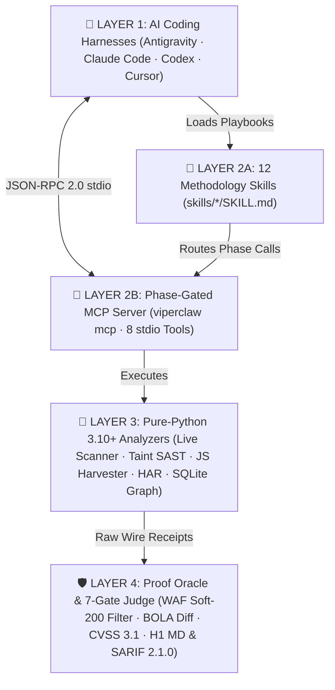

<div align="center">


<br />

<p align="center">
  <a href="https://github.com/zahidoverflow/viperclaw/releases"></a>
  <a href="https://github.com/zahidoverflow/viperclaw/actions"></a>
  <a href="https://www.python.org/"></a>
  <a href="#-phase-gated-mcp-server-viperclaw-mcp"></a>
  <a href="#-the-12-methodology-driven-skills"></a>
  <a href="https://github.com/zahidoverflow/viperclaw/blob/main/LICENSE"></a>
  <a href="https://github.com/zahidoverflow/viperclaw/stargazers"></a>
</p>

<p align="center">
  <b>ViperClaw</b> (<code>viperclaw</code> / <code>vclaw</code>) upgrades <b>Google Antigravity</b>, <b>Claude Code</b>, <b>OpenAI Codex</b>, and <b>Cursor</b> into a methodology-driven offensive security &amp; bug bounty platform—combining <b>12 offensive skills</b>, an <b>8-tool Phase-Gated MCP server</b>, a <b>Stigmergic SQLite Attack Graph</b>, <b>multi-language SAST/DAST analyzers</b>, and a <b>deterministic Wire-Check Proof Oracle</b> with <b>zero third-party runtime dependencies</b>.
</p>

<p align="center">
  <a href="#-why-most-ai-pentesting-agents-fail-in-practice">Why ViperClaw</a> •
  <a href="#-how-viperclaw-fixes-it-architecture">Architecture</a> •
  <a href="#-60-second-quickstart">Quickstart</a> •
  <a href="#-standalone-cli-showcase-viperclaw--vclaw">CLI Usage</a> •
  <a href="#-the-12-methodology-driven-skills">12 Skills</a> •
  <a href="#-phase-gated-mcp-server-viperclaw-mcp">MCP Server</a> •
  <a href="#-validated-dvwa-benchmark-scorecard-white-box--black-box">DVWA Benchmark</a> •
  <a href="#-2026-ai-pentesting-framework-comparison">Comparison</a> •
  <a href="#-frequently-asked-questions-faq">FAQ</a>
</p>

</div>

---

## 💥 Why Most "AI Pentesting Agents" Fail in Practice

<table width="100%">
  <tr>
    <td width="50%" valign="top">
      <h4>❌ Trap 1: The "150-Scanner Wrapper"</h4>
      <p>Dumping 150–200 Kali CLI tools (<code>nmap</code>, <code>nuclei</code>, <code>ffuf</code>, <code>sqlmap</code>) into an LLM causes <b>context-window rot</b>. The agent fires noisy default flags, triggers Cloudflare/Akamai WAF blocks in seconds, and hallucinates findings out of <code>200 OK</code> challenge pages.</p>
    </td>
    <td width="50%" valign="top">
      <h4>❌ Trap 2: The Heavy Container Tax</h4>
      <p>Monolithic autonomous pentesting stacks force you to spin up 4–6 Docker containers, Neo4j/Postgres clusters, and separate API budgets burning <b>$50–$150+ per run</b>—even when you <i>already</i> run a frontier AI coding harness locally.</p>
    </td>
  </tr>
</table>

### ⚡ The ViperClaw Paradigm Shift (6 Core Subsystems)

> *"A handful of sharp, deeply researched, methodology-driven skills paired with a deterministic verification oracle will outperform a giant 200-tool wrapper almost every time."*

<table width="100%">
  <tr>
    <td width="33%" valign="top">
      <h4>🕸️ Stigmergic Attack Graph</h4>
      <p><code>viperclaw.core.graph</code><br/>Zero-setup SQLite knowledge graph with <b>pheromone priority scoring</b>, decay, and live <b>Mermaid</b> topology export.</p>
    </td>
    <td width="33%" valign="top">
      <h4>🧩 Lazy-Chunk JS Harvester</h4>
      <p><code>viperclaw.analyzers.js_harvester</code><br/>Reconstructs unloaded <b>Webpack, Vite &amp; Next.js</b> lazy chunks, hidden admin APIs, IDOR/SSRF params, GraphQL ops &amp; secrets.</p>
    </td>
    <td width="33%" valign="top">
      <h4>🔬 Polyglot Taint SAST</h4>
      <p><code>viperclaw.analyzers.taint</code><br/>Multi-hop source-to-sink taint tracking across <b>Python, TS/JS, Go &amp; PHP</b> with context-aware sanitizer de-tainting.</p>
    </td>
  </tr>
  <tr>
    <td width="33%" valign="top">
      <h4>🌐 Live Wire Exploiter</h4>
      <p><code>viperclaw.analyzers.live_scanner</code><br/>Stateful cookie/CSRF session handling and <b>14 wire-verified exploit probes</b> (RCE, SQLi, LFI, Upload, XSS, CSRF, Logic).</p>
    </td>
    <td width="33%" valign="top">
      <h4>🕵️ HAR Stack Fingerprinter</h4>
      <p><code>viperclaw.analyzers.proxy_fingerprint</code><br/>Infers backend stacks (<b>FastAPI, NestJS, Spring, Laravel, Rails</b>) and sibling APIs from <b>Caido / Burp</b> <code>.har</code> captures.</p>
    </td>
    <td width="33%" valign="top">
      <h4>🛡️ 7-Gate Proof Oracle</h4>
      <p><code>viperclaw.core.oracle</code><br/>Filters Cloudflare/Akamai/Imperva <b>Soft-200</b> blocks, diffs BOLA JSON keys, scores <b>CVSS 3.1</b>, and exports <b>H1 MD + SARIF 2.1.0</b>.</p>
    </td>
  </tr>
</table>

---

## 🧬 How ViperClaw Fixes It (Architecture)

<div align="center">
  
</div>

<details>
<summary><b>📐 View Interactive Mermaid Architecture Flowchart</b></summary>
<br />



</details>

---

## 🚀 60-Second Quickstart

### 1. Clone & Install (Zero External Dependencies)

```bash
git clone https://github.com/zahidoverflow/viperclaw.git
cd viperclaw
pip install -e .
```

> **💡 Pure Python 3.10+ Stdlib:** Installs in under 2 seconds on Linux, macOS, Windows, WSL2, Docker, Kali Linux, or Android Termux and registers both `viperclaw` and shorthand `vclaw` binaries.

### 2. Install the 12 Methodology Skills into Your AI Agent Harness

```bash
# Install into Google Antigravity (~/.agents/skills)
viperclaw skills install --target antigravity

# Install into Claude Code (~/.claude/skills)
viperclaw skills install --target claude

# Install into OpenAI Codex (~/.codex/skills), Cursor (~/.cursor/skills), or all at once
viperclaw skills install --target all
```

<details>
<summary><b>📦 Using Claude Code Plugin Marketplace?</b></summary>

```text
/plugin marketplace add zahidoverflow/viperclaw
/plugin install viperclaw@viperclaw
```
</details>

### 3. Connect the Phase-Gated MCP Server (`viperclaw mcp`)

Add to your harness `mcp_config.json` / `.mcp.json` (Antigravity, Claude Code, Cursor, Windsurf, Cline) or run `claude mcp add viperclaw -- viperclaw mcp`:

```json
{
  "mcpServers": {
    "viperclaw": {
      "command": "viperclaw",
      "args": ["mcp"]
    }
  }
}
```

---

## 💻 Standalone CLI Showcase (`viperclaw` / `vclaw`)

| Command | Purpose | Key Flags |
| :--- | :--- | :--- |
| `viperclaw scan <url>` | Stateful live HTTP web scanner & wire-verified exploit runner | `--db`, `--report-md`, `--report-sarif`, `--username`, `--password` |
| `viperclaw taint <path>` | Multi-language source-to-sink taint SAST (Python, TS/JS, Go, PHP) | `--db`, `--output` |
| `viperclaw harvest-js <path>` | Webpack / Vite / Next.js lazy-chunk & API/IDOR/secret harvester | `--base-url`, `--db`, `--output` |
| `viperclaw fingerprint <har>` | Caido / Burp `.har` backend framework & sibling API fingerprinter | `--domain`, `--output` |
| `viperclaw graph` | Query top pheromone-ranked attack leads & export Mermaid graphs | `--db`, `--top-leads`, `--decay`, `--mermaid` |
| `viperclaw verify [file]` | Run the 7-Question Triage Gate, CVSS 3.1 & export H1 MD / SARIF | `--report-md`, `--report-sarif`, `--cvss-vector` |

```bash
# 1. Run a stateful live web scan & export verified HackerOne Markdown + SARIF 2.1.0
viperclaw scan http://127.0.0.1:4280 --db .viperclaw/graph.db --report-md bounty_report.md --report-sarif findings.sarif

# 2. Audit source code for multi-hop taint flows (Python / TS / JS / Go / PHP)
viperclaw taint ./target-repo --db .viperclaw/graph.db --output taint_flows.json

# 3. Reconstruct hidden SPA lazy chunks & extract API / IDOR / SSRF parameters
viperclaw harvest-js ./bundles --base-url https://app.target.tld/ --db .viperclaw/graph.db --output js_recon.json

# 4. Fingerprint backend stacks from Caido / Burp HAR traffic & view top attack leads
viperclaw fingerprint ./traffic.har --domain target.tld --output tech_stack.json
viperclaw graph --db .viperclaw/graph.db --top-leads 10 --mermaid
```

---

## 🎯 The 12 Methodology-Driven Skills

Each skill in [`skills/`](skills/) encodes a senior security researcher's decision tree, coverage matrix, bypass ladder, and stopping conditions:

| # | Skill | Focus Area & Offensive Methodology |
| :---: | :--- | :--- |
| `01` | [`viper-orchestrator`](skills/viper-orchestrator/SKILL.md) | **Master 5-Phase Orchestrator:** Stigmergic Attack Graph prioritization, hypothesis decomposition, parallel subagents & 7-Gate QA. |
| `02` | [`viper-js-harvester`](skills/viper-js-harvester/SKILL.md) | **Deep JS & Lazy-Chunk Harvester:** Reconstructs unloaded Webpack/Vite/Next.js chunk manifests, hidden admin routes & secrets. |
| `03` | [`viper-proxy-fingerprint`](skills/viper-proxy-fingerprint/SKILL.md) | **HTTP & Proxy Fingerprinter:** Maps sibling API hosts, framework error envelopes (FastAPI, NestJS, Spring, Laravel) & WAF traps. |
| `04` | [`viper-bola-idor`](skills/viper-bola-idor/SKILL.md) | **Cross-Tenant BOLA / IDOR / BFLA:** Multi-role auth matrix (Tenant A vs. Tenant B vs. Unauth), ID mutation & JSON key diffing. |
| `05` | [`viper-injection-oracle`](skills/viper-injection-oracle/SKILL.md) | **Precision Injection Oracle:** Zero-noise true/false differential pairs for SQLi, NoSQLi, SSTI, and OS Command Injection. |
| `06` | [`viper-ssrf-cloud`](skills/viper-ssrf-cloud/SKILL.md) | **SSRF & Cloud Metadata:** URL parser differentials, redirect chains, AWS/GCP/Azure IMDSv1/v2 & Kubernetes service discovery. |
| `07` | [`viper-auth-oauth-jwt`](skills/viper-auth-oauth-jwt/SKILL.md) | **Auth, OAuth 2.0 / OIDC & JWT:** `redirect_uri` bypasses, pre-ATO email collisions, JWT `RS256`→`HS256` confusion & `kid` injection. |
| `08` | [`viper-graphql-ws`](skills/viper-graphql-ws/SKILL.md) | **GraphQL & WebSocket Auditor:** Introspection bypass, field suggestion clairvoyance, nested edge BOLA, alias batching & CSWSH. |
| `09` | [`viper-race-logic`](skills/viper-race-logic/SKILL.md) | **Race Condition & Business Logic:** Single-packet HTTP/2 bursts, TOCTOU quota/coupon overruns, idempotency flaws & step skipping. |
| `10` | [`viper-taint-sast`](skills/viper-taint-sast/SKILL.md) | **White-Box Source-to-Sink Taint SAST:** Traces remote user inputs to dangerous sinks across Python, TS/JS, Go & PHP with PoCs. |
| `11` | [`viper-ai-llm-redteam`](skills/viper-ai-llm-redteam/SKILL.md) | **Agentic AI, LLM & MCP Red-Team:** Indirect prompt injection, MCP tool-call argument hijacking, RAG vector bleed & exfiltration. |
| `12` | [`viper-proof-judge`](skills/viper-proof-judge/SKILL.md) | **Zero-Context Adversarial QA Judge:** Enforces *"No Receipt, No Report"*, runs the 7-Question Gate, scores CVSS 3.1 & writes reports. |

---

## 🔌 Phase-Gated MCP Server (`viperclaw mcp`)

Instead of polluting your LLM's context window with 150 raw CLI wrappers, `viperclaw mcp` exposes **8 deterministic JSON-RPC 2.0 tools** over `stdio`:

| MCP Tool | Phase | Description |
| :--- | :---: | :--- |
| `viper_live_scan` | **Exploit / DAST** | Execute a stateful, authenticated HTTP dynamic scan against a live web target, proving exploits over the wire. |
| `viper_taint_scan` | **White-Box SAST** | Run multi-language source-to-sink taint analysis across Python, TypeScript/JavaScript, Go, and PHP. |
| `viper_harvest_js` | **Recon / SPA** | Reconstruct Webpack/Vite/Next.js lazy chunks and extract endpoints, IDOR/SSRF candidates, GraphQL ops & secrets. |
| `viper_fingerprint_traffic` | **Recon / HAR** | Fingerprint backend frameworks, WAFs, sibling API hosts, and error envelopes from `.har` captures or HTTP headers. |
| `viper_graph_upsert` | **Swarm Graph** | Upsert hosts, endpoints, lazy chunks, taint sinks, or findings into the Stigmergic SQLite Attack Graph. |
| `viper_graph_leads` | **Swarm Graph** | Query top pheromone-ranked attack leads and export a live Mermaid topology diagram. |
| `viper_diff_oracle` | **Verification** | Compare baseline vs. mutated/cross-tenant HTTP responses to confirm BOLA/IDOR and filter WAF Soft-200 blocks. |
| `viper_verify_and_report` | **Reporting** | Run the 7-Question Triage Gate, calculate exact CVSS v3.1 scores, and generate HackerOne/Bugcrowd Markdown. |

---

## 🏆 Validated DVWA Benchmark Scorecard (White-Box + Black-Box)

ViperClaw is continuously benchmarked against **Damn Vulnerable Web Application (DVWA)** across both static source auditing (`viperclaw taint`) and live containerized HTTP exploitation (`viperclaw scan`):

* **White-Box Taint SAST (`viperclaw taint`):** **19 / 19 (100%)** vulnerable modules detected via multi-hop transitive taint tracking, with **0 False Positives** on hardened `impossible.php` targets (`PDO::prepare`, `intval`, `is_numeric`, `in_array`, `htmlspecialchars`).
* **Black-Box Live Wire Exploitation (`viperclaw scan`):** **14 / 14 (100%)** live vulnerability modules exploited and verified over HTTP in under 5 seconds with raw request/response receipts:

| ID | Severity (CVSS 3.1) | Vulnerability Module | Verified Wire Proof / Exploit Vector |
| :---: | :---: | :--- | :--- |
| `VC-LIVE-001` | **HIGH (8.8)** | OS Command Injection | `ip=127.0.0.1;id` → Verified `uid=33(www-data)` execution |
| `VC-LIVE-002` | **HIGH (8.1)** | UNION SQL Injection | `' UNION SELECT user,password FROM users#` → Credential hash dump |
| `VC-LIVE-003` | **MEDIUM (6.5)** | Boolean Blind SQLi | True (`1' AND 1=1#`) vs. False (`1' AND 1=2#`) differential oracle |
| `VC-LIVE-004` | **HIGH (8.1)** | SQLi Auth Bypass | `username=admin' OR '1'='1' LIMIT 1#` → Authenticated admin session |
| `VC-LIVE-005` | **HIGH (7.1)** | Local File Inclusion (LFI) | `?page=/etc/passwd` → Verified `root:x:0:0:root:/root:/bin/bash` |
| `VC-LIVE-006` | **CRITICAL (9.9)** | Unrestricted Upload RCE | Multipart PHP upload → Verified RCE at `/hackable/uploads/viperclaw_poc.php` |
| `VC-LIVE-007` | **MEDIUM (6.1)** | Reflected XSS | Unescaped HTML payload reflection verified in DOM response |
| `VC-LIVE-008` | **MEDIUM (5.4)** | Stored XSS (Guestbook) | Persistent payload stored in `mtxMessage` and rendered to all viewers |
| `VC-LIVE-009` | **HIGH (8.2)** | Predictable Session ID | Sequential `dvwaSession` $+1$ increment proven across consecutive requests |
| `VC-LIVE-010` | **HIGH (8.8)** | CSRF Password Reset | State-changing `GET` password reset verified without anti-CSRF token |
| `VC-LIVE-011` | **MEDIUM (6.5)** | CAPTCHA Workflow Bypass | Direct `step=2` state-machine jump verified via auth oracle & restored |
| `VC-LIVE-012` | **MEDIUM (5.4)** | CSP Bypass & Script Injection | External script injection via permissive `Content-Security-Policy` & `include` |
| `VC-LIVE-013` | **MEDIUM (6.5)** | JS Token Algorithm Reversal | Reversed `md5(rot13("success"))` client-side token & verified server acceptance |
| `VC-LIVE-014` | **MEDIUM (6.1)** | DOM-Based XSS | Unescaped `location.href` sink into `document.write()` verified in browser |

---

## 📊 2026 AI Pentesting Framework Comparison

| Capability / Architecture | 🐍 ViperClaw | Strix / Shannon | PentAGI / RedAmon | HexStrike AI | Vulnhuntr |
| :--- | :---: | :---: | :---: | :---: | :---: |
| **Architecture Pattern** | **Skills + MCP + Engine** | Containerized Agent | Docker + Neo4j Stack | 150-Tool MCP | Python AST CLI |
| **Native Inside Antigravity / Claude / Codex / Cursor** | ✅ **Native** | ⚠️ CLI Wrapper | ⚠️ Partial | ✅ MCP Only | ❌ Standalone |
| **Context-Window Efficiency** | ✅ **8 Phase-Gated Tools** | ✅ Scoped | ✅ Role-Split | ❌ **150+ Dumped** | ✅ Call-Slice |
| **Zero-Setup SQLite Attack Graph + Mermaid** | ✅ **Built-in** | ❌ | ⚠️ Needs Neo4j/PG | ❌ | ❌ |
| **SPA Lazy-Chunk Reconstruction (Webpack/Vite/Next)** | ✅ **Built-in** | ⚠️ Partial | ❌ | ❌ | ❌ |
| **Multi-Language White-Box Taint SAST** | ✅ **Py / TS / Go / PHP** | ✅ Dynamic + Code | ❌ Black-Box | ❌ | ⚠️ **Py 3.10 Only** |
| **Deterministic WAF Soft-200 & BOLA Diff Oracle** | ✅ **Built-in** | ✅ PoC Validation | ⚠️ LLM-Judged | ❌ Raw Stdout | ❌ Static Only |
| **7-Gate Triage + CVSS 3.1 + H1 MD + SARIF 2.1.0** | ✅ **Built-in** | ✅ SARIF | ⚠️ Basic Report | ❌ | ❌ |
| **Runtime Dependencies** | ✅ **0 (Pure Stdlib)** | Docker + Node/LLM | Docker + DB + Kali | 150+ CLI Tools | Python 3.10 + `jedi` |

---

## 📂 Repository Structure

```text
viperclaw/
├── .claude-plugin/               # Claude Code Marketplace & Plugin manifests
├── .github/workflows/ci.yml      # GitHub Actions CI matrix (Python 3.10, 3.11, 3.12)
├── assets/                       # Custom SVG Banner & 4-Layer Architecture Diagrams
│   ├── banner.svg
│   └── architecture.svg
├── logo.png                      # Lightweight 512x512 transparent square emblem
├── skills/                       # 12 Methodology-Driven Offensive Skills (SKILL.md)
├── src/viperclaw/                # Zero-Dependency Python 3.10+ Core Package
│   ├── cli.py                    # CLI entrypoints (`viperclaw` & `vclaw`)
│   ├── mcp_server.py             # Phase-Gated 8-Tool JSON-RPC 2.0 stdio MCP Server
│   ├── core/                     # Stigmergic Attack Graph, Proof Oracle & SARIF Reporter
│   └── analyzers/                # Live HTTP Scanner, Polyglot Taint SAST, JS & HAR Analyzers
├── tests/test_viperclaw.py       # 10 End-to-End & Adversarial QA Regression Suites
├── CITATION.cff                  # Academic & Research Citation Metadata
├── glama.json                    # MCP Registry Manifest
├── llms.txt                      # AI / LLM Context Discovery Index
└── pyproject.toml                # PEP 621 Zero-Dependency Package Configuration
```

---

## ❓ Frequently Asked Questions (FAQ)

<details>
<summary><b>What is the best AI pentesting framework in 2026 for Claude Code, Google Antigravity, and Cursor?</b></summary>
<br />
<b>ViperClaw</b> is purpose-built for developers and security researchers who already run frontier coding harnesses (<b>Google Antigravity</b>, <b>Claude Code</b>, <b>OpenAI Codex</b>, or <b>Cursor</b>). Unlike standalone Docker stacks that require 4–6 containers and separate LLM API budgets, ViperClaw installs in 2 seconds with zero third-party dependencies, providing 12 methodology-driven <code>SKILL.md</code> playbooks and an 8-tool Phase-Gated MCP server (<code>viperclaw mcp</code>).
</details>

<details>
<summary><b>How does ViperClaw prevent AI hallucinations and WAF "Soft-200" false positives?</b></summary>
<br />
Generic AI hackbots often mistake a <code>200 OK</code> HTML challenge page from <b>Cloudflare, Akamai, Imperva/Incapsula, AWS CloudFront, PerimeterX, or DataDome</b> for a successful exploit. ViperClaw's deterministic <code>ProofOracle</code> inspects response headers, body signatures, structural JSON key differentials, and Soft-200 error envelopes—enforcing a strict <b>7-Question Pre-Submission Gate</b> (<i>"No Receipt, No Report"</i>) before any finding is marked verified.
</details>

<details>
<summary><b>Can ViperClaw audit both source code (White-Box SAST) and live web applications (Black-Box DAST)?</b></summary>
<br />
Yes. For <b>white-box code auditing</b>, <code>viperclaw taint</code> performs forward multi-hop source-to-sink taint tracking across <b>Python, TypeScript/JavaScript, Go, and PHP</b> while respecting sanitizers (<code>int()</code>, <code>intval()</code>, <code>PDO::prepare</code>, <code>htmlspecialchars</code>). For <b>black-box web &amp; API testing</b>, <code>viperclaw scan</code>, <code>viperclaw harvest-js</code>, and <code>viperclaw fingerprint</code> reconstruct hidden SPA lazy chunks, fingerprint backend stacks from Caido/Burp HAR files, and execute stateful wire-verified probes.
</details>

<details>
<summary><b>How do I cite ViperClaw in security research papers or blog posts?</b></summary>
<br />
This repository includes a standard <a href="CITATION.cff"><code>CITATION.cff</code></a> file. Click the <b>"Cite this repository"</b> button in the GitHub sidebar to copy the BibTeX or APA citation.
</details>

---

## 🧪 Running the Test Suite & Contributing

```bash
pytest -v
```

Contributions, new offensive skills, and sanitizer/sink rules are welcome! Please review [`CONTRIBUTING.md`](CONTRIBUTING.md) and our [`SECURITY.md`](SECURITY.md) policy before opening a pull request.

---

## ⚠️ Legal & Responsible Use Disclaimer

**ViperClaw** is developed strictly for **authorized security assessments, bug bounty programs with explicit scope permission, educational labs (HackTheBox / TryHackMe / DVWA / CTFs), and defensive code auditing**. Never test targets without prior written authorization.

---

## 📜 License & Author

* **License:** [MIT License](LICENSE) — 100% clean-room open-source implementation.
* **Created by:** **Zahidul Islam ([@zahidoverflow](https://github.com/zahidoverflow))**
* ⭐ **If ViperClaw sharpens your offensive workflows, star the repository and share it with the community!**
