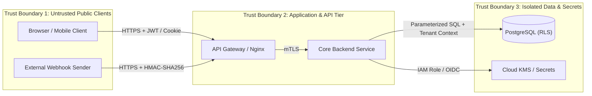

# ViperClaw Skill 64: STRIDE Threat Modeling & Trust Boundary Architect (`viper-threat-model-stride`)

## 1. Standards & Open-Source Reference
- **Standards:** OWASP Threat Modeling Cheat Sheet, Microsoft STRIDE Methodology, Trail of Bits Architectural Risk Assessment.
- **Focus:** Producing structured architectural threat models, Trust Boundary Data Flow Diagrams (Mermaid), and prioritized security control roadmaps before or during a codebase audit.

## 2. 4-Question Threat Modeling Framework
1. **What are we building?** (Map External Entities, Processes, Data Stores, Data Flows, and Trust Boundaries).
2. **What can go wrong?** (Apply **STRIDE** systematically across every flow crossing a Trust Boundary).
3. **What are we going to do about it?** (Map each threat to a concrete preventive/detective code control and ViperClaw audit skill).
4. **Did we do a good job?** (Verify controls via automated regression tests and `viperclaw taint` / `viperclaw verify`).

## 3. STRIDE Per-Boundary Audit Matrix
| Category | Security Property | Primary Architectural Failure | Mitigating Control & ViperClaw Skill |
| :--- | :--- | :--- | :--- |
| **S**poofing | Authentication | Forged JWTs, missing webhook HMAC, weak OAuth/WebAuthn validation | `viper-auth-oauth-jwt`, `viper-webauthn-passkey-mfa`, `viper-webhook-edr-hmac` |
| **T**ampering | Integrity | SQL/Command injection, mass assignment, TOCTOU races, unsigned CI artifacts | `viper-injection-oracle`, `viper-race-logic`, `viper-sbom-slsa-provenance` |
| **R**epudiation | Non-Repudiation | Missing audit logs on privilege/financial actions, log injection | `viper-logging-pii-compliance`, `viper-payment-stripe-pci` |
| **I**nformation Disclosure | Confidentiality | Cross-tenant BOLA/IDOR, RAG vector bleed, hardcoded secrets, SSRF to IMDS | `viper-bola-idor`, `viper-multitenant-isolation`, `viper-rag-vector-audit`, `viper-secrets-audit` |
| **D**enial of Service | Availability | Unbounded GraphQL batching, ReDoS regex, missing Go/gRPC timeouts, poison queues | `viper-rate-limit-dos-resilience`, `viper-graphql-ws`, `viper-go-service-audit` |
| **E**levation of Privilege | Authorization | Missing BFLA role guards, `iam:PassRole` escalation, privileged K8s pods | `viper-bola-idor`, `viper-aws-iam-cloud-audit`, `viper-container-k8s-audit` |

## 4. Mermaid Trust-Boundary DFD Template

