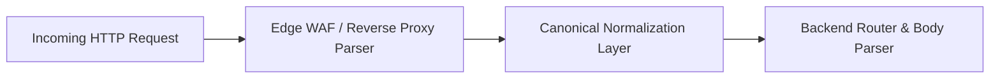

# Reverse-Proxy, WAF & Backend Parser Consistency Auditor (`viper-waf-evasion-framing`)

## 1. Executive Scope, Standards & CWE/OWASP Mapping
- **Frameworks & Standards:** OWASP WSTG-CONF, RFC 9110/9112 (HTTP Semantics), CWE-436 (Interpretation Conflict), CWE-178
- **Primary CWE Mapping:** CWE-436 (Interpretation Conflict Between Proxy/WAF and Backend), CWE-235 (Improper Handling of Extra Parameters / HPP), CWE-444 (Inconsistent Interpretation of HTTP Requests)
- **ViperClaw MCP Tools:** `viper_fingerprint_traffic`, `viper_diff_oracle`, `viper_verify_and_report`
- **ViperClaw CLI Command:** `viperclaw fingerprint ./traffic.har --output proxy_audit.json`

---

## 2. Threat Model & Root-Cause Architecture



### Root-Cause Analysis
Security controls fail when an upstream WAF or reverse proxy parses paths, headers, query parameters, or body encodings differently than the downstream web framework (e.g., Nginx vs. Spring path parameters `/admin;v=1`, duplicate JSON keys, or uninspected `Content-Type` charsets).

---

## 3. Deterministic Discovery & Grep/AST Audit Commands

Run the following discovery commands across the target repository before manual code review:

```bash
# 1. Automated ViperClaw analysis
viperclaw fingerprint ./traffic.har --output proxy_audit.json

# 2. Rapid static pattern discovery (ripgrep)
rg -n "(Content-Type|application/x-www-form-urlencoded|multipart/form-data|application/json)"
rg -n "(req\.query|request\.args|request\.GET|parse_qs)"
rg -n "(Transfer-Encoding|Content-Length|X-Original-URL|X-Rewrite-URL)"
```

---

## 4. Senior Security Engineer 8-Point Audit Checklist

| Control ID | Audit Verification Target | Pass Criteria | Fail / Vulnerability Indicator |
| :---: | :--- | :--- | :--- |
| `WAF-01` | **Strict Content-Type Allowlisting** | Backend controllers explicitly reject requests whose `Content-Type` does not match the endpoint contract (e.g., `415 Unsupported Media Type`). | JSON endpoint also accepts `application/x-www-form-urlencoded` or `text/plain`, bypassing WAF JSON rules or CSRF preflights. |
| `WAF-02` | **Path Normalization Consistency** | Reverse proxy and backend normalize `;` matrix parameters, `%2f` encoded slashes, and dot-segments identically. | Proxy ACL blocks `/admin/*` but passes `/api/../admin` or `/admin;foo=bar` to Spring/Tomcat. |
| `WAF-03` | **HTTP Parameter Pollution (HPP) Precedence** | Duplicate query parameters (`?role=user&role=admin`) are rejected or handled with identical first/last precedence across proxy and app. | WAF inspects first parameter (`role=user`) while Express/PHP/Python reads the last or an array. |
| `WAF-04` | **Duplicate JSON Key Rejection** | JSON parsers reject payloads containing duplicate object keys (`{"admin":false,"admin":true}`). | Upstream validator checks first key while downstream parser overwrites with the last key. |
| `WAF-05` | **Routing Override Header Stripping** | Edge proxy strips untrusted `X-Original-URL`, `X-Rewrite-URL`, `X-Forwarded-Host`, and `X-Forwarded-Prefix` headers. | Client supplies `X-Original-URL: /admin/users` to bypass front-end path restrictions. |
| `WAF-06` | **Body Size & Inspection Limit Alignment** | Maximum request body size at the reverse proxy is `<=` the WAF's maximum payload inspection limit (e.g., 8KB/64KB). | Backend accepts 10MB JSON bodies while the cloud WAF only inspects the first 8KB. |
| `WAF-07` | **HTTP/1.1 Desync & Framing Hygiene** | Front-end and back-end servers use HTTP/2 end-to-end or normalize `Transfer-Encoding` and reject ambiguous `Content-Length` + `Transfer-Encoding` requests. | Ambiguous chunked framing accepted by edge proxy (CWE-444). |
| `WAF-08` | **Code-Level Root-Cause Remediation** | Every vulnerability is patched in application code (parameterization/authZ) rather than relying solely on WAF virtual patches. | SQLi or BOLA left unpatched in code behind a regex WAF rule. |

---

## 5. False-Positive Elimination & CVSS v3.1 Triage Rubric

### False-Positive Gate
1. Verify whether an upstream API Gateway, global middleware, or ORM hook already enforces the control before flagging a controller.
2. Confirm the code path is reachable from an external entrypoint (not dead code, CLI-only admin script, or unit-test fixture).

| Severity Tier | Baseline CVSS v3.1 Vector | Qualifying Security Impact |
| :--- | :--- | :--- |
| **CRITICAL (9.1)** | `CVSS:3.1/AV:N/AC:L/PR:N/UI:N/S:U/C:H/I:H/A:N` | Path normalization or `X-Original-URL` discrepancy bypassing authentication on `/admin` endpoints. |
| **HIGH (7.5)** | `CVSS:3.1/AV:N/AC:L/PR:N/UI:N/S:U/C:H/I:N/A:N` | Duplicate JSON key or HPP discrepancy bypassing authorization or input validation filters. |
| **MEDIUM (5.3)** | `CVSS:3.1/AV:N/AC:L/PR:N/UI:N/S:U/C:N/I:L/A:N` | Unrestricted Content-Type acceptance or missing header stripping at the reverse proxy. |

---

## 6. Production Remediation Patterns (Vulnerable vs. Hardened Code)

```nginx
# ❌ VULNERABLE: Passes untrusted X-Original-URL & unnormalized path directly to backend
location / {
    proxy_pass http://backend_upstream;
}

# ✅ HARDENED: Strips routing override headers, caps body size to WAF limit & normalizes URI
location / {
    client_max_body_size 64k;
    proxy_set_header X-Original-URL "";
    proxy_set_header X-Rewrite-URL "";
    proxy_set_header X-Forwarded-Host $host;
    proxy_pass http://backend_upstream;
}
```

---

## 7. Regression Testing & Continuous Verification
1. Write a **Positive Unit Test** confirming authorized, schema-valid requests succeed.
2. Write a **Negative Security Regression Test** confirming unauthorized, cross-tenant, or malformed inputs are deterministically rejected.
3. Re-run `viperclaw taint` and `viperclaw verify` to confirm zero remaining unmitigated flows in `.viperclaw/graph.db`.
